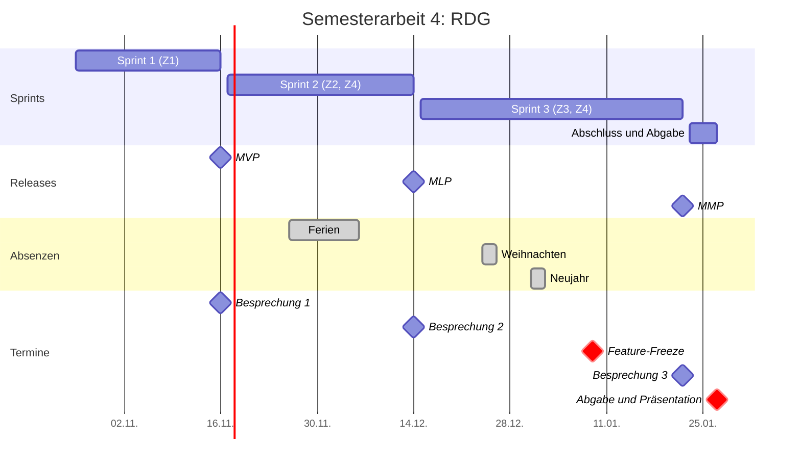
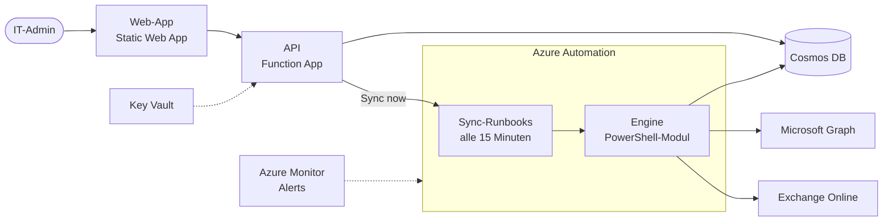
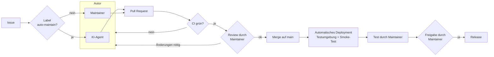

# RDG Semesterarbeit: Gesamtdokument

Dieses Dokument fasst alle Seiten der Online-Dokumentation <https://ruminahuim.github.io/rdg-semesterarbeit/> zu einer Datei zusammen. Es wird bei jeder Änderung automatisch neu erzeugt.

| | |
| :--- | :--- |
| Stand | 08.11.2026, Commit 2801b45 |
| Online-Version | <https://ruminahuim.github.io/rdg-semesterarbeit/> |

## Inhalt

- [RDG als DevOps-Projekt mit KI-Wartung](#doc-start)
- [Projektdokumentation](#doc-projektdokumentation)
- Projekt
    - [Projekt-Steckbrief](#doc-projekt-steckbrief)
    - [Einreichungsformular](#doc-projekt-einreichungsformular)
    - [Roadmap](#doc-projekt-roadmap)
    - [Scrum-Setup](#doc-projekt-scrum-setup)
    - [Risk Register](#doc-projekt-risk-register)
    - [Findings](#doc-projekt-findings)
    - [Traceability](#doc-projekt-traceability)
- [Sprints](#doc-sprints)
    - Sprint 1
        - [Sprint 1: Planning](#doc-sprints-sprint-1-planning)
        - [Sprint 1: Daily Journal](#doc-sprints-sprint-1-daily)
        - [Sprint 1: Review](#doc-sprints-sprint-1-review)
        - [Sprint 1: Retrospektive](#doc-sprints-sprint-1-retro)
    - Sprint 2
        - [Sprint 2: Planning](#doc-sprints-sprint-2-planning)
        - [Sprint 2: Daily Journal](#doc-sprints-sprint-2-daily)
        - [Sprint 2: Review](#doc-sprints-sprint-2-review)
        - [Sprint 2: Retrospektive](#doc-sprints-sprint-2-retro)
    - Sprint 3
        - [Sprint 3: Planning](#doc-sprints-sprint-3-planning)
        - [Sprint 3: Daily Journal](#doc-sprints-sprint-3-daily)
        - [Sprint 3: Review](#doc-sprints-sprint-3-review)
        - [Sprint 3: Retrospektive](#doc-sprints-sprint-3-retro)
- [Besprechungen](#doc-besprechungen)
    - [Besprechung 1](#doc-besprechungen-besprechung-1)
    - [Besprechung 2](#doc-besprechungen-besprechung-2)
    - [Besprechung 3](#doc-besprechungen-besprechung-3)
- Nachweise
    - [Testprotokoll](#doc-nachweise-testprotokoll)
    - [Auswertung der KI-Wartung](#doc-nachweise-ki-auswertung)
- Abschluss
    - [Schlusspräsentation](#doc-abschluss-praesentation)
- Anhang
    - [Quellen](#doc-anhang-quellen)
    - [Glossar](#doc-anhang-glossar)

# RDG als DevOps-Projekt mit KI-Wartung

| | |
| :--- | :--- |
| Titel der Semesterarbeit | RDG als DevOps-Projekt mit KI-Wartung: Eine Pipeline, die GitHub-Issues selbst löst |
| Name | Dodoe Rumiñahui Mannale |
| Studiengang | Dipl. Informatiker/in HF, ITCNE25, TBZ |
| Semester / Abgabe | Semester 4 / 27.01.2027 |
| Themenfelder | Projektmanagement, DevOps |

Diese Seite ist die Dokumentation meiner 4. Semesterarbeit. Sie wird laufend nachgeführt und zeigt jederzeit den aktuellen Stand.

## Worum geht es?

RDG (Real Dynamic Groups) ist ein Tool, das ich bei meiner Arbeit gebaut habe. Es pflegt Gruppen in Microsoft 365 nach Regeln und schreibt das Resultat als normale Mitgliederliste in die Gruppe. So funktionieren die Gruppen auch dort, wo Microsoft dynamische Gruppen ablehnt.

In dieser Arbeit mache ich aus RDG ein sauberes DevOps-Projekt: mit Tests, automatischem Deployment in eine Testumgebung und einer Release-Freigabe von Hand. Danach probiere ich aus, wie gut ein KI-Agent bei der Wartung helfen kann, und werte das aus.

## Ziele

| Ziel | Kurz | Umfang |
| --- | --- | --- |
| Z1 | Sauberes DevOps-Projekt: Repo, Branch-Schutz, CI-Pipeline, Kanban-Board | Must |
| Z2 | Automatisches Deployment in die Testumgebung und Release-Freigabe von Hand | Must |
| Z3 | KI-Wartung als Versuch mit 8 Test-Issues und Auswertung | Must (Durchführung und Auswertung) |
| Z4 | Die KI bleibt eingeschränkt (nur Pull Requests, keine Rechte auf Umgebungen) | Must |

Details im [Einreichungsformular](#doc-projekt-einreichungsformular).

## Aktueller Stand

| | |
| :--- | :--- |
| Aktueller Sprint | Sprint 1 (26.10. bis 16.11.2026) |
| Nächste Besprechung | 16.11.2026 |
| Feature-Freeze | 09.01.2027 |

## Links

| Was | Wo |
| --- | --- |
| Produkt-Repository (RDG, Open Source) | [github.com/RuminahuiM/rdg](https://github.com/RuminahuiM/rdg) |
| Repository dieser Dokumentation | [github.com/RuminahuiM/rdg-semesterarbeit](https://github.com/RuminahuiM/rdg-semesterarbeit) |
| Kanban-Board (GitHub Projects) | [RDG Semesterarbeit 4](https://github.com/users/RuminahuiM/projects/1) |

## Aufbau dieser Dokumentation

| Bereich | Inhalt |
| --- | --- |
| [Projektdokumentation](#doc-projektdokumentation) | Der Schlussbericht mit Teil A Projektmanagement und Teil B fachliche Umsetzung. Wird laufend ergänzt |
| [Projekt](#doc-projekt-steckbrief) | Steckbrief, Einreichungsformular, Roadmap, Scrum-Setup, Risk Register, Findings, Traceability |
| [Sprints](#doc-sprints) | Planning, Daily Journal, Review und Retrospektive pro Sprint |
| [Besprechungen](#doc-besprechungen) | Vorbereitung und Protokolle der Einzelbesprechungen mit den Experten |

Die Doku des Produkts selbst (Requirements, Design, Architekturentscheide, Guides) liegt im RDG-Repository, weil sie zum Tool gehört und dort weiterlebt.

# Projektdokumentation

| | |
| :--- | :--- |
| Titel der Semesterarbeit | RDG als DevOps-Projekt mit KI-Wartung: Eine Pipeline, die GitHub-Issues selbst löst |
| Name | Dodoe Rumiñahui Mannale |
| Studiengang | Dipl. Informatiker/in HF, ITCNE25, TBZ |
| Semester / Abgabe | Semester 4 / 27.01.2027 |
| Themenfelder | Projektmanagement, DevOps |

Diese Projektdokumentation besteht aus **Teil A Projektmanagement** (Kapitel 1 bis 6) und **Teil B fachliche Umsetzung** (Kapitel 7 bis 13), gefolgt vom gemeinsamen **Anhang** (Kapitel 14). Sie wird während der Arbeit laufend ergänzt. Details liegen in den verlinkten Seiten dieser Doku, im [Kanban-Board](https://github.com/users/RuminahuiM/projects/1) und im Produkt-Repository [RuminahuiM/rdg](https://github.com/RuminahuiM/rdg).

!!! info "Stand 08.11.2026"
    Gerüst mit allen Kapiteln. Was schon feststeht, ist ausgefüllt. Kapitel mit dem Hinweis "Folgt" werden im genannten Sprint ergänzt.

## Inhaltsverzeichnis

**Teil A: Projektmanagement**

1. [Einleitung](#1-einleitung)
2. [Projektmethodik](#2-projektmethodik)
3. [Planung](#3-planung)
4. [Durchführung](#4-durchfuhrung)
5. [Risikomanagement](#5-risikomanagement)
6. [Reflexion Projektmanagement](#6-reflexion-projektmanagement)

**Teil B: Fachliche Umsetzung**

7. [Fachlicher Kontext und Theorie](#7-fachlicher-kontext-und-theorie)
8. [Anforderungen](#8-anforderungen)
9. [Architektur und Design](#9-architektur-und-design)
10. [Umsetzung](#10-umsetzung)
11. [Test und Qualitätssicherung](#11-test-und-qualitatssicherung)
12. [Ergebnis und Abnahme](#12-ergebnis-und-abnahme)
13. [Reflexion fachlich](#13-reflexion-fachlich)

**Anhang**

14. [Anhang und Verzeichnisse](#14-anhang-und-verzeichnisse)

## Zusammenfassung

!!! info "Folgt am Schluss"
    Kurze Zusammenfassung auf einer halben Seite: Ausgangslage, Vorgehen, wichtigste Ergebnisse pro Ziel, Fazit der KI-Auswertung.

---

## Teil A: Projektmanagement

## 1. Einleitung

### 1.1 Ausgangslage und Problemstellung

In Microsoft 365 gibt es dynamische Gruppen, die ihre Mitglieder automatisch nach Regeln füllen. In der Praxis reichen sie oft nicht: Viele Funktionen akzeptieren keine dynamischen Gruppen (z.B. mail-aktivierte Gruppen, Verteilerlisten oder gewisse Defender- und Exchange-Richtlinien), man kann Regel und manuelle Ausnahmen nicht mischen, und die Regel-Möglichkeiten sind begrenzt. Darum habe ich bei meiner Arbeit das Tool RDG (Real Dynamic Groups) gebaut. RDG wertet die Regeln selbst aus und schreibt das Resultat als normale Mitgliederliste in die Gruppe.

RDG ist bisher ein MVP. Es läuft in Azure und wird beim ersten Anwender getestet. Die Pipelines sind angelegt, aber nie richtig getestet, und das Deployment mache ich von Hand von meinem PC aus. Dazu kommt: Ich werde die Firma voraussichtlich bald verlassen, und danach pflegt niemand RDG weiter.

Ich möchte RDG darum als Open-Source-Projekt veröffentlichen, das möglichst wenig Wartung von Hand braucht. Zuerst setze ich es sauber als DevOps-Projekt auf. Danach probiere ich aus, wie gut ein KI-Agent bei der Wartung helfen kann, und werte das aus.

### 1.2 Project Summary

!!! info "Folgt am Schluss"
    Kurzer Überblick über das ganze Projekt: was gemacht wurde, mit welchen Mitteln, mit welchem Ergebnis.

### 1.3 Stakeholder

| Stakeholder | Rolle | Interesse |
| --- | --- | --- |
| Ich (Studierender) | Product Owner, Scrum Master, Developer | Erfolgreiche Semesterarbeit, RDG langfristig wartbar machen |
| Corrado Parisi | Experte Projektmanagement | Sauberes agiles Vorgehen, nachvollziehbare Planung und Steuerung |
| Thanam Pangri, Patrick (Zuteilung wird bestätigt) | Experten DevOps | Fachlich korrekte Umsetzung von CI/CD, Deployment und KI-Pipeline |
| Erster Anwender von RDG (mein Arbeitgeber) | Kunde | RDG weiter nutzen können, auch ohne mich |
| Open-Source-Community | spätere Nutzer und Mitwirkende | Verständliches, sicheres und gepflegtes Tool |

*Tabelle 1: Stakeholder*

### 1.4 Ziele (SMART)

| Ziel | Beschreibung | Messgrösse (Nachweis) | Termin | Umfang |
| --- | --- | --- | --- | --- |
| Z1 | Sauberes DevOps-Projekt: Repository mit Branching-Strategie, Kanban-Board, SemVer, Merge nur per Pull Request mit grüner CI | Ein absichtlich fehlerhafter Pull Request wird blockiert | 16.11.2026 | Must |
| Z2 | Automatisches Deployment in die Testumgebung (mit Smoke-Test) und Release-Freigabe von Hand | Mindestens 5 automatische Deployments, mindestens ein freigegebenes Release | 14.12.2026 | Must |
| Z3 | KI-Wartung als Versuch mit vier Issue-Arten | Auswertung von 8 Test-Issues: Ergebnis, eigener Aufwand, Dauer, Kosten | 22.01.2027 | Must (Durchführung und Auswertung) |
| Z4 | Die KI bleibt eingeschränkt: nur Pull Requests, kein Zugriff auf Umgebungen, nur meine Issues | Prompt-Injection-Test führt zu keiner unerlaubten Aktion | 22.01.2027 | Must |

*Tabelle 2: Ziele*

### 1.5 Scope und Abgrenzung

| In Scope | Out of Scope |
| --- | --- |
| RDG als DevOps-Projekt aufnehmen: Repository, Arbeitsregeln, Tests, Doku | Neue Funktionen von RDG selbst |
| Alle Pipelines (CI, Deployment, Release), auch die bestehenden | Kubernetes (Ausnahme für diese Arbeit, abgesprochen am 21.10.2026; folgt in der 5. Semesterarbeit) |
| KI-Pipeline für vier Issue-Arten mit Auswertung | Weitere Issue-Arten und ein KI-Helfer in der Web-App (optional) |
| Testumgebung in einem eigenen Test-Tenant | Änderungen an der produktiven Installation beim ersten Anwender |

*Tabelle 3: Scope*

## 2. Projektmethodik

### 2.1 Warum Scrum

Ich arbeite mit Scrum, weil ich möglichst viel Übung im agilen Arbeiten sammeln will. In einem DevOps-Team ist ein agiles Vorgehen wie Scrum üblich, darum wende ich es hier so realistisch wie möglich an.

Ehrlich gesagt ist Scrum für einen Solo-Entwickler nicht die praktischste Wahl. Rollen, Events und Artefakte sind für Teams gedacht, und einiges davon wirkt allein künstlich. Für mich allein hätte wohl auch ein einfaches Kanban gereicht. Ich nehme den Mehraufwand bewusst in Kauf und prüfe in den Retrospektiven, welche Teile auch allein helfen und welche nicht (siehe Kapitel 6.1). Gut passt, dass die drei festen Besprechungen der TBZ als Sprint-Enden dienen: Nach jedem Sprint zeige ich einen lauffähigen Stand und hole Feedback ab.

Innerhalb eines Sprints nutze ich das Board in GitHub Projects wie ein Kanban-Board, damit ich sehe, wo jede Story steht und was blockiert ist.

### 2.2 Scrum in der Solo-Anwendung

Ich übernehme alle drei Verantwortlichkeiten (Product Owner, Scrum Master, Developer). Wie ich Events, Artefakte und die Grenzen der Solo-Anwendung handhabe, steht im [Scrum-Setup](#doc-projekt-scrum-setup).

### 2.3 User Stories, Akzeptanzkriterien, Definition of Ready und Done

Jede Story ist ein Issue mit Akzeptanzkriterien als Checkliste. Ein Item wechselt im Board erst von Backlog zu ToDo, wenn es die Definition of Ready erfüllt. Definition of Ready und Definition of Done stehen im [Scrum-Setup](#definition-of-ready).

### 2.4 Schätzung und Priorisierung

Schätzung mit Story Points nach Fibonacci, Priorisierung nach MoSCoW (Labels `must`, `should`, `could`, `wont`).

### 2.5 Werkzeuge

| Werkzeug | Wofür |
| --- | --- |
| GitHub Projects | Kanban-Board, Product Backlog, Sprint-Übersicht |
| GitHub (zwei Repositories) | Produkt-Code (`rdg`) und Projektdokumentation (`rdg-semesterarbeit`) |
| GitHub Actions | CI, Deployment, Release, KI-Pipeline, Veröffentlichung dieser Doku |
| GitHub Pages mit Material for MkDocs | Veröffentlichung dieser Dokumentation |
| MS Teams | Kommunikation mit den Experten |
| Claude (Anthropic) | KI-Agent in der Pipeline (Gegenstand der Arbeit) und KI-Assistent bei der Arbeit (siehe [Deklaration](#141-deklaration-der-ki-nutzung)) |

*Tabelle 4: Werkzeuge*

### 2.6 Arbeiten mit KI-Unterstützung

KI kommt in dieser Arbeit auf zwei Arten vor:

1. **Als Gegenstand der Arbeit:** Ein KI-Agent soll in der Pipeline Issues bearbeiten (Z3), mit klaren Grenzen (Z4).
2. **Als Assistent bei meiner Arbeit:** Ich nutze Claude beim Planen, Recherchieren, Schreiben und Programmieren.

Für den zweiten Punkt gelten feste Regeln: Ich prüfe alle Ergebnisse selbst, Änderungen am Code laufen wie alle anderen über Pull Request und CI, und ich verantworte alles, was abgegeben wird. Die Deklaration steht in [Kapitel 14.1](#141-deklaration-der-ki-nutzung).

Um den Effekt sichtbar zu machen, vergleiche ich pro Story die Schätzung (Story Points, als Richtwert ohne KI in Stunden umgerechnet) mit der tatsächlich gebrauchten Zeit aus dem Daily Journal. Die Auswertung folgt in Kapitel 6.

## 3. Planung

### 3.1 Roadmap und Releases

| Release | Ende | Was der Release bringt |
| --- | --- | --- |
| MVP | Sprint 1, 16.11.2026 | RDG liegt sauber auf GitHub, Board steht, Branch-Schutz aktiv, CI-Pipeline grün (Z1) |
| MLP | Sprint 2, 14.12.2026 | Automatisches Deployment in die Testumgebung, Release nur nach Freigabe (Z2), erste KI-Pipeline mit Sicherheitsregeln (Z4) |
| MMP | Sprint 3, 22.01.2027 | KI-Pipeline für vier Issue-Arten, 8 Test-Issues ausgewertet, Prompt-Injection-Test (Z3, Z4) |

*Tabelle 5: Releases*

### 3.2 Gantt-Chart

*Abbildung 1: Gantt-Chart mit Sprints, Releases, Absenzen und Terminen*

Ab dem **Feature-Freeze am 09.01.2027** kommen keine neuen Funktionen mehr dazu. Die Zeit bis zur Abgabe ist für Tests, Fehlerbehebung, Auswertung und Dokumentation reserviert.

### 3.3 Product Backlog

Der Backlog liegt im [Kanban-Board](https://github.com/users/RuminahuiM/projects/1). Pro Ziel gibt es ein Epic, die Stories hängen als Unter-Issues daran.

| Epic | Kürzel | Ziel |
| --- | --- | --- |
| Projektmanagement und Kommunikation | PM | |
| Sauberes DevOps-Projekt | CI | Z1 |
| Automatisches Deployment und Release-Freigabe | DEP | Z2 |
| Die KI bleibt eingeschränkt | SEC | Z4 |
| KI-Wartung als Versuch | AI | Z3 |
| Dokumentation und Abschluss | DOC | |

*Tabelle 6: Epics*

### 3.4 Kapazität und Sprint-Kalender

Gearbeitet wird am Samstag und Sonntag (je ca. 5 h) und am Mittwoch (mindestens ca. 4 h). Nicht gearbeitet wird in den Ferien vom 26.11. bis 06.12.2026, an Weihnachten (24. bis 26.12.) und über Neujahr (31.12. bis 02.01.). Pro Sprint plane ich ca. 20 Prozent Reserve ein. Die TBZ gibt ca. 50 Stunden als Richtwert vor, meine Kapazität liegt deutlich darüber.

| Abschnitt | Arbeitstage | Kapazität | davon planbar (80 %) |
| --- | --- | --- | --- |
| Sprint 1 (ab Start der Umsetzung am 07.11.) | So 08.11., Mi 11.11., Sa 14.11., So 15.11. | ca. 19 h | ca. 15 h |
| Sprint 2 | Mi 18.11., Sa 21.11., So 22.11., Mi 25.11., Mi 09.12., Sa 12.12., So 13.12. | ca. 32 h | ca. 25.5 h |
| Sprint 3 bis Feature-Freeze | Mi 16.12., Sa 19.12., So 20.12., Mi 23.12., So 27.12., Mi 30.12., So 03.01., Mi 06.01. | ca. 36 h | ca. 29 h |
| Sprint 3 nach Feature-Freeze | Sa 09.01., So 10.01., Mi 13.01., Sa 16.01., So 17.01., Mi 20.01. | ca. 28 h | Tests, Auswertung, Doku |
| Abschluss | Sa 23.01., So 24.01., Mi 27.01. | ca. 14 h | Präsentation, Abgabe |

*Tabelle 15: Sprint-Kalender mit echten Arbeitstagen*

Sprint 2 ist durch die Ferien deutlich kürzer als die anderen Sprints. Das ist im Risk Register erfasst (R-S01) und wird im Sprint 2 Planning beim Umfang berücksichtigt.

### 3.5 SWOT-Analyse

| | Hilfreich | Hinderlich |
| --- | --- | --- |
| **Intern** | **Stärken:** RDG existiert als funktionierendes MVP mit Tests, Mocks und Pipelines; ich kenne das Tool und das Umfeld genau | **Schwächen:** Solo-Projekt ohne Code-Review durch eine zweite Person; begrenzte Zeit neben Beruf und Schule |
| **Extern** | **Chancen:** KI-Agenten in CI/CD sind 2026 verfügbar und gut dokumentiert; Open Source macht RDG für andere nutzbar | **Risiken:** KI-Ergebnisse schwer vorhersehbar; Test-Tenant und Azure kosten Geld; Abhängigkeit von externen Diensten (GitHub, Azure, Anthropic) |

*Tabelle 7: SWOT-Analyse (Stand 07.11.2026)*

## 4. Durchführung

### 4.1 Sprint 1: Sauberes DevOps-Projekt

!!! info "Folgt nach Sprint 1"
    Ziel, Ergebnis, abgeschlossene Stories, Velocity, Abweichungen. Details im [Sprint 1](#doc-sprints-sprint-1-planning).

### 4.2 Sprint 2: Deployment, Release und erste KI-Pipeline

!!! info "Folgt nach Sprint 2"

### 4.3 Sprint 3: KI-Wartung als Versuch

!!! info "Folgt nach Sprint 3"

### 4.4 Fortschritt: Velocity und Burn-up

!!! info "Folgt ab Sprint 1"
    Geplante und erledigte Story Points pro Sprint, Burn-up-Chart aus dem Board.

### 4.5 Kommunikation mit den Experten

| Datum | Mit | Thema | Ergebnis |
| --- | --- | --- | --- |
| 21.10.2026 | Thanam Pangri, Marcel Bernet | Kubernetes-Vorgabe | Ausnahme für diese Arbeit |
| 07.11.2026 | Corrado Parisi | Feedback zum Einreichungsformular | Formular überarbeitet (Version 2) und gesendet, Freigabe ausstehend |

*Tabelle 8: Abstimmungen mit den Experten*

Weitere Details unter [Besprechungen](#doc-besprechungen).

## 5. Risikomanagement

### 5.1 Methodik

Risiken werden nach Wahrscheinlichkeit und Auswirkung (je 1 bis 3) bewertet, der Score ist das Produkt. Ab Score 4 wird ein Risiko aktiv beobachtet, ab Score 6 hat es hohe Priorität. Jedes Risiko hat eine vorbeugende Massnahme und einen Plan B. Das ganze Register steht im [Risk Register](#doc-projekt-risk-register).

### 5.2 Wichtigste Risiken und Massnahmen

| ID | Risiko | Score | Massnahme |
| --- | --- | --- | --- |
| R-T01 | Die KI macht falsche Änderungen | 6 | CI-Pipeline, Prüfung jedes Pull Requests, Test vor dem Release |
| R-T02 | Prompt Injection oder zu viele Rechte für den Agenten | 6 | Nur meine Issues, minimale Rechte, kein Zugriff auf Umgebungen, eigener Test |
| R-K01 | Der KI-Teil ist schwieriger als gedacht | 6 | Z1 und Z2 zuerst, vier klar begrenzte Issue-Arten |
| R-E01 | Testumgebung nicht rechtzeitig verfügbar | 6 | Test-Tenant zu Beginn von Sprint 2, Mocks als Plan B |
| R-S01 | Sprints laufen über, besonders Sprint 2 wegen der Ferien | 9 | 20 Prozent Reserve, MoSCoW, Should- und Could-Stories zuerst streichen, Umfang von Sprint 2 im Planning bewusst klein halten |
| R-S02 | Zu wenig Zeit für Doku am Schluss | 6 | Feature-Freeze 09.01.2027, Doku laufend in jedem Sprint |

*Tabelle 9: Risiken mit hoher Priorität (Stand 07.11.2026)*

### 5.3 Eingetretene Risiken und Reaktion

!!! info "Folgt laufend"

## 6. Reflexion Projektmanagement

### 6.1 Solo-Scrum: was trug und was fehlte

!!! info "Folgt am Schluss"

### 6.2 Planung, Schätzung und Zeit

!!! info "Folgt am Schluss"

### 6.3 Handlungsempfehlungen

!!! info "Folgt am Schluss"

---

## Teil B: Fachliche Umsetzung

## 7. Fachlicher Kontext und Theorie

### 7.1 RDG kurz erklärt

RDG (Real Dynamic Groups) pflegt die Mitglieder von Microsoft-365-Gruppen nach Regeln. Die Regeln schreibt man in derselben Syntax wie bei dynamischen Gruppen in Entra ID. RDG wertet sie regelmässig aus und schreibt das Resultat als normale, statische Mitglieder in die Gruppe. Dadurch funktioniert die Gruppe überall, wo eine statische Gruppe funktioniert, zum Beispiel als Empfänger in Defender-Richtlinien oder als Verteilerliste.

Was RDG kann:

- **Gruppen erstellen oder übernehmen:** Eine Definition kann eine neue Gruppe anlegen oder eine bestehende Gruppe übernehmen (adopt). RDG pflegt die Gruppe danach weiter, mit derselben Gruppen-ID und Mailadresse, sodass bestehende Verweise weiter funktionieren.
- **Alle Gruppentypen:** Sicherheitsgruppen, Microsoft-365-Gruppen, mail-aktivierte Sicherheitsgruppen und Verteilerlisten.
- **Regeleditor:** Die Regel wird schon beim Tippen geprüft, mit demselben Parser, den auch die Engine verwendet.
- **Manuelle Ausnahmen:** Einzelne Personen lassen sich fix hinzufügen oder ausschliessen, zusätzlich zur Regel.
- **Vorschau:** Zeigt, wer im Moment zur Regel passt und was sich an der Gruppe ändern würde.
- **Schutz vor Fehlern:** Im Modus DryRun zeichnet RDG Änderungen nur auf, ohne sie auszuführen. Ändert sich ein Lauf mehr als einen eingestellten Prozentsatz der Mitglieder, wartet RDG auf eine Freigabe durch einen Admin.
- **Bedienung und Nachvollziehbarkeit:** Sync per Knopfdruck ("Sync now"), Übersicht über die Aktivität aller Gruppen, Audit-Trail (wer hat wann was geändert) und zwei Rollen (Admin und Reader).

RDG besteht aus einer Engine (PowerShell in Azure Automation), einer API (Azure Functions), einer Web-App (React, Azure Static Web Apps) und einer Datenbank (Cosmos DB). Die Infrastruktur wird mit OpenTofu beschrieben und im Tenant des Anwenders installiert (siehe [Kapitel 9.1](#91-ausgangslage-architektur-von-rdg)).

### 7.2 DevOps, CI/CD und Continuous Delivery

DevOps bringt Entwicklung und Betrieb zusammen: Änderungen sollen klein, häufig und sicher in Betrieb gehen. Zwei Bausteine sind dafür zentral:

- **Continuous Integration (CI):** Jede Änderung wird automatisch gebaut und getestet, bevor sie in den Hauptstand kommt. Bei RDG prüft die CI-Pipeline Linting, Unit-Tests, Verträge der API, die Infrastruktur und Sicherheitsregeln (siehe [Kapitel 11.1](#111-teststrategie)).
- **Continuous Delivery (CD):** Jeder geprüfte Stand kann jederzeit ausgeliefert werden. Bei RDG heisst das: Jeder Merge auf `main` landet automatisch in der Testumgebung (Z2). Ein Release für Anwender entsteht aber erst nach einer Freigabe von Hand. Das ist der Unterschied zu Continuous Deployment, wo jede Änderung ohne Freigabe in Produktion geht.

Wie gut eine Auslieferung funktioniert, misst die DORA-Forschung mit fünf Kennzahlen: Change Lead Time, Deployment Frequency, Failed Deployment Recovery Time, Change Fail Rate und Deployment Rework Rate.[^p2-dora] Für diese Arbeit sind vor allem die Deployment Frequency und die Change Lead Time interessant, weil sie zeigen, wie schnell eine Änderung (auch vom KI-Agenten) in der Testumgebung ankommt.

### 7.3 GitHub Flow, Conventional Commits und SemVer

- **GitHub Flow:** Für jede Änderung ein kurzer Branch von `main`, dann ein Pull Request, Prüfung, Merge und Löschen des Branches.[^p2-flow] `main` ist immer lauffähig. Für ein kleines Projekt ohne parallele Release-Linien ist das einfacher als Git Flow. Der Entscheid wird in Story CI-3 als ADR festgehalten.
- **Conventional Commits:** Commit-Nachrichten haben eine feste Form wie `feat: ...`, `fix: ...` oder `docs: ...`.[^p2-cc] So kann man aus der Historie ablesen, was sich geändert hat, und die nächste Versionsnummer ableiten.
- **Semantic Versioning (SemVer):** Versionen haben die Form `MAJOR.MINOR.PATCH`.[^p2-semver] MAJOR steigt bei inkompatiblen Änderungen, MINOR bei neuen Funktionen, PATCH bei Fehlerkorrekturen. Vorabversionen wie `0.1.0-eval.4` sind erlaubt und zeigen, dass RDG noch nicht stabil ist.

### 7.4 Infrastructure as Code mit OpenTofu

Bei Infrastructure as Code wird die Infrastruktur als Code beschrieben, versioniert und automatisch ausgerollt, statt sie von Hand im Portal anzulegen. RDG nutzt dafür OpenTofu, die Open-Source-Variante von Terraform. Ein `plan` zeigt vor jeder Änderung, was passieren würde, ein `apply` setzt es um. In der CI-Pipeline wird die Konfiguration mit einem gemockten Provider getestet (`tofu test`), also ohne echte Azure-Ressourcen.

### 7.5 KI-Agenten in der Softwarewartung

Ein KI-Agent ist ein Sprachmodell, das nicht nur Text erzeugt, sondern in mehreren Schritten Werkzeuge benutzt: Dateien lesen, Code ändern, Tests ausführen und einen Pull Request erstellen. In GitHub Actions kann ein solcher Agent durch ein Ereignis gestartet werden, zum Beispiel durch ein Issue mit einem bestimmten Label.[^p2-agent]

Die Ergebnisse eines Agenten sind nicht vorhersehbar: Er kann eine Aufgabe sauber lösen, nur teilweise lösen oder etwas Falsches mit grosser Überzeugung vorschlagen. Darum bleibt in dieser Arbeit ein Mensch an zwei Stellen in der Schleife (Human in the Loop): beim Review des Pull Requests und bei der Freigabe des Releases. Was der Agent konkret kann und wo er scheitert, ist genau die Frage von Z3.

Für die Kosten ist wichtig, wie sich der Agent anmeldet. Die Claude-Code-Action kann sich mit einem API-Key (Abrechnung pro Token) oder mit einem OAuth-Token aus einem Claude-Abo anmelden. Mit dem Token laufen die Durchläufe über das Abo statt über die API-Abrechnung.[^p2-gha] Die Durchläufe teilen sich dann aber die Limits mit meiner normalen Nutzung des Abos. Ob das im Alltag reicht und stabil läuft, prüfe ich in Sprint 2 (Story AI-9).

!!! info "Wird mit den ersten Versuchen in Sprint 2 vertieft"

### 7.6 Sicherheit: Least Privilege, OIDC und Prompt Injection

- **Least Privilege:** Jede Komponente bekommt nur die Rechte, die sie wirklich braucht. Für den Agenten heisst das: Er darf einen Branch und einen Pull Request erstellen, aber nicht auf `main` pushen und nicht auf Azure zugreifen (Z4).
- **OIDC statt Secrets:** Mit OpenID Connect holt sich ein Workflow für jeden Lauf ein kurzlebiges Token von Azure. Es gibt kein langlebiges Passwort, das gestohlen werden könnte.[^p2-oidc] Welcher Workflow ein Token bekommt, legt eine Vertrauensregel in Azure fest (z.B. nur `main` oder nur eine bestimmte Umgebung).
- **Prompt Injection:** Ein Angreifer versteckt Anweisungen in einem Text, den das Modell liest, zum Beispiel in einem Issue. Die OWASP Top 10 für LLM-Anwendungen führen das als grösstes Risiko (LLM01), zusammen mit "Excessive Agency" (LLM06), also zu vielen Rechten für ein Modell.[^p2-owasp] Gegenmassnahmen sind genau die Grenzen aus Z4: nur Issues von mir, minimale Rechte, Prüfung durch einen Menschen. Ein eigener Test prüft das (T-07 im [Testprotokoll](#doc-nachweise-testprotokoll)).

Eine Idee, die ich als optionale Story prüfe (SEC-5): Statt dass Issues direkt an den Agenten gehen, nimmt ein KI-Chat die Anliegen entgegen und erstellt daraus ein sauberes Issue nach Vorlage. Das ähnelt dem "Dual LLM"-Muster: Ein Modell liest den unsicheren Text, hat aber keine gefährlichen Rechte, und nur sein strukturiertes Ergebnis geht weiter.[^p2-dual] Ganz verhindern lässt sich Prompt Injection so nicht, weil auch der Chat den Text des Angreifers liest. Der mögliche Schaden wird aber kleiner.

[^p2-dora]: DORA, "DORA's software delivery performance metrics", <https://dora.dev/guides/dora-metrics-four-keys>, Zugriff 08.11.2026.
[^p2-flow]: GitHub Docs, "GitHub flow", <https://docs.github.com/en/get-started/using-github/github-flow>, Zugriff 08.11.2026.
[^p2-cc]: Conventional Commits 1.0.0, <https://www.conventionalcommits.org/en/v1.0.0/>, Zugriff 08.11.2026.
[^p2-semver]: Semantic Versioning 2.0.0, <https://semver.org/>, Zugriff 08.11.2026.
[^p2-agent]: Background Claude, "Claude Code in GitHub Actions: the v1 recipe, with guardrails", <https://backgroundclaude.com/blog/github-actions>, Zugriff 07.11.2026.
[^p2-oidc]: GitHub Docs, "Configuring OpenID Connect in Azure", <https://docs.github.com/en/actions/how-tos/secure-your-work/security-harden-deployments/oidc-in-azure>, Zugriff 08.11.2026.
[^p2-gha]: Anthropic, "Claude Code GitHub Actions", <https://code.claude.com/docs/en/github-actions>, Zugriff 08.11.2026.
[^p2-dual]: Simon Willison, "The Dual LLM pattern for building AI assistants that can resist prompt injection", <https://simonwillison.net/2023/Apr/25/dual-llm-pattern/>, Zugriff 08.11.2026.
[^p2-owasp]: PointGuard AI, "Understanding the 2025 OWASP Top 10 for LLM Applications", <https://www.pointguardai.com/blog/understanding-the-owasp-top-10-for-llms>, Zugriff 08.11.2026.

## 8. Anforderungen

Die Anforderungen leiten sich aus den Zielen Z1 bis Z4 ab. Jede Anforderung hat einen Nachweis im [Testprotokoll](#doc-nachweise-testprotokoll) oder in der [KI-Auswertung](#doc-nachweise-ki-auswertung). Die Anforderungen an RDG selbst stehen im Design im RDG-Repository und sind nicht Teil dieser Arbeit.

### 8.1 Funktionale Anforderungen

| ID | Anforderung | Ziel | Nachweis |
| --- | --- | --- | --- |
| FR-01 | Auf `main` kann nur per Pull Request gemergt werden, und nur wenn die CI grün ist | Z1 | T-01, T-02 |
| FR-02 | Die CI prüft bei jedem Pull Request Linting, Tests, API-Verträge, Infrastruktur und Sicherheit | Z1 | CI-Läufe |
| FR-03 | Jeder Merge auf `main` deployt automatisch in die Testumgebung | Z2 | T-03, T-05 |
| FR-04 | Nach jedem Deployment entscheidet ein Smoke-Test über Erfolg oder Misserfolg | Z2 | T-03 |
| FR-05 | Ein Release (SemVer-Tag mit Paket) entsteht nur nach meiner Freigabe | Z2 | T-04 |
| FR-06 | Ein Issue mit dem Label `auto-maintain` von mir startet den KI-Agenten | Z3 | AI-1, KI-Auswertung |
| FR-07 | Der Agent erstellt Branch, Änderung, Tests und Pull Request | Z3 | KI-Auswertung |
| FR-08 | Pro Durchlauf sind Dauer und Kosten nachvollziehbar | Z3 | KI-Auswertung |

*Tabelle 16: Funktionale Anforderungen*

### 8.2 Nicht-funktionale Anforderungen

| ID | Anforderung | Ziel | Nachweis |
| --- | --- | --- | --- |
| NFR-01 | Keine langlebigen Azure-Credentials in der Pipeline (Login per OIDC) | Z2, Z4 | Konfiguration, ADR 0001 |
| NFR-02 | Der Agent hat minimale Rechte: kein Push auf `main`, kein Zugriff auf Azure und die Umgebungen | Z4 | T-07, T-08 |
| NFR-03 | Der Agent reagiert nur auf Issues von mir | Z4 | T-06 |
| NFR-04 | Pro Durchlauf gibt es Limits für Kosten und Laufzeit | Z3, Z4 | Konfiguration, KI-Auswertung |
| NFR-05 | Jeder Schritt ist nachvollziehbar (Pipeline-Logs, Pull Requests, Board) | Z1 bis Z4 | Logs, Board |
| NFR-06 | Keine Secrets und keine echten Tenant- oder Personendaten in den Repositories | Compliance | Security-Job der CI, Review |
| NFR-07 | Der Agent verursacht möglichst keine zusätzlichen Kosten: Betrieb über das bestehende Claude-Abo, API-Key nur als Fallback mit Limit | Z3 | AI-9, KI-Auswertung |

*Tabelle 17: Nicht-funktionale Anforderungen*

## 9. Architektur und Design

### 9.1 Ausgangslage: Architektur von RDG

RDG läuft vollständig in einer Azure-Ressourcengruppe im Tenant des Anwenders.

*Abbildung 2: Komponenten von RDG (vereinfacht)*

Die API und die Runbooks verwenden dasselbe Engine-Modul. Darum liefern die Vorschau in der Web-App und der echte Sync dieselben Resultate.

### 9.2 Ablauf von der Änderung bis zum Release

*Abbildung 3: Ablauf vom Issue bis zum Release*

Ist die CI rot oder verlangt das Review Änderungen, geht der Pull Request zurück an den Autor, also an den KI-Agenten oder an den Maintainer. Der Maintainer prüft zweimal: den Code vor dem Merge und die laufende Version vor dem Release. In dieser Arbeit bin ich der Maintainer. Nach der Veröffentlichung als Open Source können es auch andere Personen sein.

### 9.3 Schnittstellen und Einflussgrössen

| Schnittstelle | Wofür | Einfluss auf das Projekt |
| --- | --- | --- |
| GitHub (Repos, Actions, Projects, Pages) | Code, Pipelines, Board, Doku | Zentrale Plattform, Limits des Free-Plans |
| Microsoft Azure | Testumgebung von RDG | Kosten (ca. 27 USD pro Monat), Login aus der Pipeline per OIDC |
| Microsoft-365-Test-Tenant | Gruppen und Benutzer für Tests | Muss zuerst eingerichtet werden (Sprint 2) |
| Claude (Anthropic), angemeldet über das Pro-Abo, API-Key nur als Fallback | KI-Agent in der Pipeline | Limits des Abos werden mit meiner normalen Nutzung geteilt, Qualität der Ergebnisse |
| Experten und Teams-Kanal | Feedback, Freigaben | Feste Besprechungstermine bestimmen die Sprint-Längen |

*Tabelle 10: Schnittstellen und Einflussgrössen*

### 9.4 Evaluation der Lösungsansätze

Wichtige Entscheidungen werden im RDG-Repository als Architecture Decision Record (ADR) festgehalten, mit Varianten, Kriterien und Begründung.

| Entscheidung | Varianten | Entscheid | ADR |
| --- | --- | --- | --- |
| Plattform für das automatische Deployment | GitHub Actions, Azure DevOps, Deployment von Hand | GitHub Actions | [ADR 0001](https://github.com/RuminahuiM/rdg/pull/1) (Proposed) |
| Branching-Strategie | GitHub Flow, Git Flow, Trunk-based | folgt | folgt in Sprint 1 (CI-3) |
| Lizenz | MIT, Apache-2.0, GPL-3.0 | folgt | folgt in Sprint 1 (CI-1) |
| Login aus der Pipeline nach Azure | OIDC, Client-Secret | folgt | folgt in Sprint 2 (DEP-3) |
| KI-Agent in der Pipeline | Claude Code in GitHub Actions, andere Agenten | folgt | folgt in Sprint 2 |
| Anmeldung und Kosten des Agenten | Claude-Abo (OAuth-Token), API-Key, selbst gehostetes Open-Source-Modell | folgt | folgt in Sprint 2 (AI-9, AI-10) |

*Tabelle 11: Entscheidungen und Varianten*

### 9.5 Compliance und rechtliche Aspekte

| Thema | Umgang in dieser Arbeit |
| --- | --- |
| Lizenz | RDG wird Open Source. Die Lizenz wird in Story CI-1 gewählt und als ADR begründet. Dabei prüfe ich auch, ob die Lizenzen der verwendeten Bibliotheken dazu passen |
| Datenschutz | In den Repositories und in der Testumgebung gibt es keine echten Personendaten. Testbenutzer sind erfunden, Beispiele verwenden `contoso`. Der KI-Agent sieht nur Code und Issue-Texte |
| Secrets | Keine Passwörter oder Schlüssel in den Repositories. Login nach Azure per OIDC (ADR 0001). Die CI scannt die Infrastruktur auf unsichere Einstellungen |
| Produktive Umgebung | Die Installation beim ersten Anwender wird in dieser Arbeit nicht verändert. Getestet wird nur im eigenen Test-Tenant |
| KI-generierter Code und Text | Wird wie jeder andere Beitrag geprüft (Pull Request, CI, Review). Die Nutzung ist in [Kapitel 14.1](#141-deklaration-der-ki-nutzung) deklariert |

*Tabelle 18: Compliance*

## 10. Umsetzung

!!! info "Folgt pro Sprint"
    Pro Teil: was umgesetzt wurde, wichtige Code- oder Konfigurationsausschnitte, Screenshots.

### 10.1 Repository und Arbeitsregeln (Z1)

### 10.2 CI-Pipeline (Z1)

### 10.3 Deployment und Release (Z2)

### 10.4 KI-Pipeline (Z3)

### 10.5 Sicherheitsrahmen für den Agenten (Z4)

## 11. Test und Qualitätssicherung

### 11.1 Teststrategie

RDG bringt bereits eine CI-Pipeline mit mehreren Testebenen mit. Sie wird in Sprint 1 repariert (CI-4) und ist danach Pflicht für jeden Merge.

| Ebene | Was geprüft wird | Werkzeug | CI-Job |
| --- | --- | --- | --- |
| Statische Analyse | PowerShell-Regeln, Formatierung, Linting, Typen | PSScriptAnalyzer, Prettier, ESLint, TypeScript | powershell lint, web |
| Unit-Tests | Engine, API, Runbooks, Web-App | Pester, Vitest | engine, web |
| Regel-Konformität | Auswertung der Regeln gleich wie bei Entra ID | eigene Conformance-Suite | engine |
| Verträge | JSON-Schemas, Fixtures, OpenAPI | Redocly, Schema-Checks | contracts |
| End-to-End | Web-App gegen gemockte API | Playwright | web |
| Infrastruktur | Format, Validierung, Lint, Plan mit gemocktem Provider | OpenTofu, TFLint | infra |
| Sicherheit | unsichere Infrastruktur-Einstellungen, verwundbare Pakete | Trivy, npm audit | security |

*Tabelle 19: Bestehende Testebenen von RDG*

Neu dazu kommen in dieser Arbeit:

- **Smoke-Test nach jedem Deployment** in der Testumgebung (Z2)
- **Tests der Pipeline selbst**, z.B. ob ein fehlerhafter Pull Request blockiert wird oder der Agent ohne Berechtigung startet (T-01 bis T-08 im [Testprotokoll](#doc-nachweise-testprotokoll))
- **Manuelle Tests in der Testumgebung** vor jedem Release, mit Screenshot als Nachweis

### 11.2 Testprotokoll

Testfälle und Ergebnisse stehen im [Testprotokoll](#doc-nachweise-testprotokoll).

### 11.3 Nachweise pro Ziel

| Ziel | Nachweis | Ort |
| --- | --- | --- |
| Z1 | Fehlerhafter Pull Request wird blockiert | [Testprotokoll](#doc-nachweise-testprotokoll) |
| Z2 | 5 automatische Deployments, 1 freigegebenes Release | [Testprotokoll](#doc-nachweise-testprotokoll) |
| Z3 | Auswertung der 8 Test-Issues | [KI-Auswertung](#doc-nachweise-ki-auswertung) |
| Z4 | Prompt-Injection-Test | [Testprotokoll](#doc-nachweise-testprotokoll) |

*Tabelle 12: Nachweise pro Ziel*

## 12. Ergebnis und Abnahme

### 12.1 Zielerreichung

| Ziel | Erreicht | Nachweis | Bemerkung |
| --- | --- | --- | --- |
| Z1 | offen | | |
| Z2 | offen | | |
| Z3 | offen | | |
| Z4 | offen | | |

*Tabelle 13: Zielerreichung*

### 12.2 Auswertung der KI-Wartung

!!! info "Folgt in Sprint 3"
    Zusammenfassung der [KI-Auswertung](#doc-nachweise-ki-auswertung): was die KI kann, wo sie scheitert, wie viel Aufwand für mich bleibt.

### 12.3 Installation und Inbetriebnahme

Die Installation von RDG ist im Install Guide im RDG-Repository beschrieben (`docs/guides/20-install-guide.md`).

!!! info "Folgt in Sprint 2"
    Wie die Testumgebung für diese Arbeit aufgesetzt wird und wie die Pipelines (Deployment, Release, KI-Agent) eingerichtet werden.

### 12.4 Übergabe und offene Punkte

!!! info "Folgt am Schluss"

## 13. Reflexion fachlich

!!! info "Folgt am Schluss"

### 13.1 Vorbehalte gegenüber der eigenen Lösung

### 13.2 Erkenntnisse

### 13.3 Handlungsempfehlungen für das weitere Vorgehen

---

## Anhang

## 14. Anhang und Verzeichnisse

### 14.1 Deklaration der KI-Nutzung

!!! info "Wird laufend ergänzt"
    Für Recherche, Texte und Code habe ich Claude (Anthropic) als Assistenten eingesetzt. Alle Ergebnisse habe ich geprüft und verantworte sie selbst. Übernommene fremde Texte und Code-Teile sind im Text mit Quelle gekennzeichnet.

### 14.2 Repository-Navigation und Setup

| Was | Wo |
| --- | --- |
| Produkt-Code von RDG | [github.com/RuminahuiM/rdg](https://github.com/RuminahuiM/rdg) |
| Installationsanleitung RDG | `docs/guides/20-install-guide.md` im RDG-Repository |
| Diese Dokumentation | [github.com/RuminahuiM/rdg-semesterarbeit](https://github.com/RuminahuiM/rdg-semesterarbeit), lokal ansehen mit `pip install -r requirements.txt` und `mkdocs serve` |
| Kanban-Board | [GitHub Projects](https://github.com/users/RuminahuiM/projects/1) |

*Tabelle 14: Repository-Navigation*

### 14.3 Quellenverzeichnis

Siehe [Quellen](#doc-anhang-quellen).

### 14.4 Glossar

Siehe [Glossar](#doc-anhang-glossar).

### 14.5 Abbildungsverzeichnis

| Nr. | Abbildung | Kapitel |
| --- | --- | --- |
| 1 | Gantt-Chart mit Sprints, Releases, Absenzen und Terminen | [3.2](#32-gantt-chart) |
| 2 | Komponenten von RDG (vereinfacht) | [9.1](#91-ausgangslage-architektur-von-rdg) |
| 3 | Ablauf vom Issue bis zum Release | [9.2](#92-ablauf-von-der-anderung-bis-zum-release) |

### 14.6 Tabellenverzeichnis

| Nr. | Tabelle | Kapitel |
| --- | --- | --- |
| 1 | Stakeholder | [1.3](#13-stakeholder) |
| 2 | Ziele | [1.4](#14-ziele-smart) |
| 3 | Scope | [1.5](#15-scope-und-abgrenzung) |
| 4 | Werkzeuge | [2.5](#25-werkzeuge) |
| 5 | Releases | [3.1](#31-roadmap-und-releases) |
| 6 | Epics | [3.3](#33-product-backlog) |
| 7 | SWOT-Analyse | [3.5](#35-swot-analyse) |
| 8 | Abstimmungen mit den Experten | [4.5](#45-kommunikation-mit-den-experten) |
| 9 | Risiken mit hoher Priorität | [5.2](#52-wichtigste-risiken-und-massnahmen) |
| 10 | Schnittstellen und Einflussgrössen | [9.3](#93-schnittstellen-und-einflussgrossen) |
| 11 | Entscheidungen und Varianten | [9.4](#94-evaluation-der-losungsansatze) |
| 12 | Nachweise pro Ziel | [11.3](#113-nachweise-pro-ziel) |
| 13 | Zielerreichung | [12.1](#121-zielerreichung) |
| 14 | Repository-Navigation | [14.2](#142-repository-navigation-und-setup) |
| 15 | Sprint-Kalender mit echten Arbeitstagen | [3.4](#34-kapazitat-und-sprint-kalender) |
| 16 | Funktionale Anforderungen | [8.1](#81-funktionale-anforderungen) |
| 17 | Nicht-funktionale Anforderungen | [8.2](#82-nicht-funktionale-anforderungen) |
| 18 | Compliance | [9.5](#95-compliance-und-rechtliche-aspekte) |
| 19 | Bestehende Testebenen von RDG | [11.1](#111-teststrategie) |

# Projekt

## Projekt-Steckbrief

Zentrale Stammdaten der Semesterarbeit.

### Stammdaten

| Feld | Wert |
| --- | --- |
| Titel | RDG als DevOps-Projekt mit KI-Wartung: Eine Pipeline, die GitHub-Issues selbst löst |
| Produkt-Repository | [RuminahuiM/rdg](https://github.com/RuminahuiM/rdg) (öffentlich, Open Source) |
| Doku-Repository | [RuminahuiM/rdg-semesterarbeit](https://github.com/RuminahuiM/rdg-semesterarbeit) (öffentlich, GitHub Pages) |
| Studierender | Dodoe Rumiñahui Mannale |
| Studiengang / Klasse | Dipl. Informatiker/in HF, ITCNE25, TBZ |
| Semester | 4 |
| Form | Solo |
| Themenfelder | Projektmanagement (Pflicht), DevOps |
| Experten | Projektmanagement: Corrado Parisi. Fachlich (DevOps): Thanam Pangri und Patrick (Zuteilung wird bestätigt) |
| Zeitbudget | ca. 50 Stunden (Vorgabe TBZ), max. 12 Wochen |

### Termine

| Termin | Datum | Notiz |
| --- | --- | --- |
| Einreichung Formular | 21.10.2026 | Version 2 nach Feedback am 07.11.2026 |
| Besprechung 1 | 16.11.2026 | Ende Sprint 1 |
| Besprechung 2 | 14.12.2026 | Ende Sprint 2 |
| Besprechung 3 | 22.01.2027 | Ende Sprint 3 |
| Feature-Freeze | 09.01.2027 | Danach nur noch Tests, Fehlerbehebung, Auswertung und Doku |
| Abgabe mit Schlusspräsentation | 27.01.2027 | Termine laut Ablaufplan der TBZ sind fix |

### Arbeitsrhythmus

| Wann | Kapazität |
| --- | --- |
| Samstag und Sonntag | je ca. 4 bis 6 h (geplant mit 5 h) |
| Mittwoch | mindestens ca. 4 h |
| Übrige Tage | keine Projektarbeit |

### Absenzen

| Zeitraum | Grund |
| --- | --- |
| 26.11. bis 06.12.2026 | Ferien |
| 24.12. bis 26.12.2026 | Weihnachten |
| 31.12.2026 bis 02.01.2027 | Silvester und Neujahr |

Der Sprint-Kalender mit den echten Arbeitstagen und der Kapazität pro Sprint steht in der [Projektdokumentation, Kapitel 3.4](#34-kapazitat-und-sprint-kalender).

### Sprints

| Sprint | Zeitraum | Ziel | Status |
| --- | --- | --- | --- |
| 1 | 26.10. bis 16.11.2026 | Sauberes DevOps-Projekt: Repos, Board, Branch-Schutz, CI-Pipeline repariert und getestet (Z1) | aktiv |
| 2 | 17.11. bis 14.12.2026 | Automatisches Deployment in die Testumgebung und Release mit Freigabe (Z2), erste KI-Pipeline mit Sicherheitsregeln (Z4) | geplant |
| 3 | 15.12.2026 bis 22.01.2027 | KI-Pipeline fertig, 8 Test-Issues und Prompt-Injection-Test durchspielen und auswerten (Z3, Z4) | geplant |
| Abschluss | 23.01. bis 27.01.2027 | Reflexion, Schlusspräsentation, Abgabe | geplant |

**Aktueller Sprint:** 1

### Tracking

| Feld | Wert |
| --- | --- |
| Tool | GitHub Projects (Kanban-Board), Issues im RDG-Repository |
| Status-Workflow | To Do, In Progress, In Review, Done |
| Priorisierung | MoSCoW (Must, Should, Could, Won't) |
| Schätzung | Story Points (Fibonacci) |

### Ziele

1. **Z1 Sauberes DevOps-Projekt:** Branch-Schutz auf `main`, Merge nur per Pull Request mit grüner CI. Nachweis: Ein absichtlich fehlerhafter Pull Request wird blockiert.
2. **Z2 Automatisches Deployment und Freigabe:** Jeder Merge auf `main` deployt automatisch in die Testumgebung (mit Smoke-Test), ein Release gibt es nur nach Freigabe von Hand. Nachweis: mindestens 5 automatische Deployments und ein freigegebenes Release.
3. **Z3 KI-Wartung als Versuch:** 8 Test-Issues aus vier Issue-Arten, pro Issue Ergebnis, eigener Aufwand, Dauer und Kosten. Nachweis: Auswertung mit Erfolgen und Grenzen.
4. **Z4 Die KI bleibt eingeschränkt:** kein Push auf `main`, kein Zugriff auf Azure und die Umgebungen, reagiert nur auf meine Issues. Nachweis: Prompt-Injection-Test ohne unerlaubte Aktion.

### Projektspezifische Regeln

- **Kubernetes:** Für diese Arbeit ausnahmsweise nicht nötig (abgesprochen mit Thanam Pangri und Marcel Bernet am 21.10.2026). Kubernetes kommt in die 5. Semesterarbeit.
- **Keine echten Firmendaten:** Keine Passwörter, Secrets oder echten Tenant-Daten in den Repositories. Beispiele verwenden `contoso`.
- **Getestet wird im eigenen Test-Tenant:** Die produktive Installation beim ersten Anwender wird in dieser Arbeit nicht verändert.
- **Die KI arbeitet nur über Pull Requests:** Jeder Pull Request wird vor dem Merge von mir geprüft.

## Einreichungsformular

| | |
| :--- | :--- |
| Name | Mannale Dodoe |
| Titel | RDG als DevOps-Projekt mit KI-Wartung: Eine Pipeline, die GitHub-Issues selbst löst |
| Themenfelder | Projektmanagement (Pflicht), DevOps |

### Versionen

| Version | Datum | Inhalt |
| --- | --- | --- |
| 1 | 21.10.2026 | Erste Einreichung im Teams-Kanal |
| 2 | 07.11.2026 | Im Teams-Thread an Corrado Parisi gesendet, Freigabe ausstehend. Überarbeitet nach dem Feedback des PM-Experten: Mindestumfang CI/CD, KI-Wartung als Versuch mit Auswertung, Kubernetes-Ausnahme, Ablauf vom Pull Request bis zum Release, Feature-Freeze, laufende Dokumentation |

Unten steht der Text der Version 2.

#### Problemstellung / Ausgangslage / Potential der Semesterarbeit

**Hintergrund:** In Microsoft 365 gibt es dynamische Gruppen, die ihre Mitglieder automatisch nach Regeln füllen (z. B. alle Benutzer einer Abteilung). In der Praxis reichen sie oft nicht: Viele Funktionen akzeptieren keine dynamischen Gruppen (z. B. mail-aktivierte Gruppen, Verteilerlisten oder gewisse Defender- und Exchange-Richtlinien), man kann Regel und manuelle Ausnahmen nicht mischen und die Regel-Möglichkeiten sind begrenzt. Darum habe ich bei meiner Arbeit (HEKS) das Tool RDG (Real Dynamic Groups) gebaut. RDG wertet die Regeln selbst aus und schreibt das Resultat als normale Mitgliederliste in die Gruppe. So funktionieren die Gruppen auch dort, wo Microsoft dynamische Gruppen ablehnt.

**Ausgangslage:** RDG ist bisher ein MVP. Es läuft in Azure (PowerShell, kleine Web-App, Infrastruktur mit OpenTofu) und wird bei HEKS getestet. Das Projekt liegt aber nur in einem Ordner. Es wurde halb von Hand eingerichtet, die Pipelines sind zwar angelegt, aber nie richtig getestet worden, und das Deployment mache ich von Hand von meinem PC aus. Dazu kommt: Ich werde die Firma voraussichtlich bald verlassen, und danach gibt es niemanden, der RDG weiterpflegt. Ohne Wartung kann die Firma das Tool wahrscheinlich nicht weiter einsetzen, was schade wäre.

**Problemstellung:** Ich möchte RDG darum als Open-Source-Projekt veröffentlichen, das möglichst wenig Wartung von Hand braucht. Zuerst setze ich es sauber als DevOps-Projekt auf: mit Tests, automatischem Deployment in eine Testumgebung und einer Freigabe von Hand für jedes Release. Danach probiere ich aus, wie gut eine KI bei der Wartung helfen kann: Wenn ich auf GitHub ein Issue erfasse (z. B. einen kleinen Bug), soll ein KI-Agent (Claude) den Code ändern, Tests ergänzen und einen Pull Request eröffnen. Ich prüfe jeden Pull Request, bevor er gemergt wird, und teste die neue Version, bevor ich sie freigebe.

**Potential:** Wenn das klappt, kann RDG auch ohne mich weiterleben und von HEKS und anderen Firmen genutzt werden. Weil RDG ein kleines und klar abgegrenztes Tool ist, eignet es sich gut, um auszuprobieren, was KI-gestützte Wartung heute schon kann und wo sie an ihre Grenzen kommt. Gleichzeitig wende ich die Inhalte aus dem DevOps-Unterricht (Git, CI/CD, Tests, Deployment, Monitoring) an einem echten Projekt an.

**Kubernetes:** Für diese Arbeit darf ich ausnahmsweise ohne Kubernetes arbeiten (abgesprochen mit Thanam Pangri und Marcel Bernet am 21.10.2026), weil Kubernetes bei RDG keinen echten Nutzen hätte. Kubernetes baue ich dafür in meine 5. Semesterarbeit ein.

### Zielsetzung der Semesterarbeit

Das Wichtigste sind Z1, Z2 und Z4: eine funktionierende CI/CD-Pipeline mit Tests, automatischem Deployment in die Testumgebung und einer Release-Freigabe von Hand. Z3 ist ein Versuch: Ich will herausfinden und aufschreiben, was die KI schafft und was nicht.

**Z1 – Sauberes DevOps-Projekt:** RDG liegt in einem GitHub-Repository mit dokumentierter Branching-Strategie, einem Kanban-Board mit User Stories und Versionen nach SemVer. Auf main kann nur per Pull Request gemergt werden, und nur wenn die CI-Pipeline grün ist. Nachweis: Ein absichtlich fehlerhafter Pull Request wird blockiert.

**Z2 – Automatisches Deployment und Freigabe:** Jeder Merge auf main baut automatisch ein Release-Paket und deployt es ohne Handarbeit in die Testumgebung, inklusive Smoke-Test. Ich deploye nicht mehr von meinem PC aus. Ein Release gibt es erst, wenn ich die Version in der Testumgebung getestet und in der Pipeline von Hand freigegeben habe. Nachweis: mindestens 5 erfolgreiche automatische Deployments in die Testumgebung und ein Release, das erst nach meiner Freigabe erstellt wurde.

**Z3 – KI-Wartung als Versuch:** Die KI bekommt nur vier Arten von Issues: kleine Bugs, die man klar nachstellen kann, fehlende Tests, Fehler in der Dokumentation und Updates von Abhängigkeiten, welche die CI-Pipeline kaputt machen. Wenn ich ein Issue mit dem Label "auto-maintain" erfasse, erstellt ein KI-Agent einen Branch, ändert den Code, ergänzt Tests und eröffnet einen Pull Request. Ich bereite 8 Test-Issues vor (2 pro Art) und schreibe bei jedem auf: Hat es geklappt (ganz, teilweise oder gar nicht)? Wie viel Zeit musste ich selbst noch investieren? Wie lange hat es gedauert und was hat es gekostet? Nachweis: eine Auswertung der 8 Issues, die zeigt, was die KI gut kann, wo sie scheitert und wie viel Arbeit für mich bleibt. Auch wenn die KI wenig schafft, ist das ein gültiges Ergebnis.

**Z4 – Die KI bleibt eingeschränkt:** Der KI-Agent kann nicht direkt auf main pushen, hat keinen Zugriff auf Azure und die Umgebungen und reagiert nur auf Issues von mir. Nachweis: Ein Test-Issue mit einer versteckten falschen Anweisung (Prompt Injection) führt zu keiner unerlaubten Aktion.

**Optional, falls Zeit bleibt:** weitere Arten von Issues (z. B. kleine Erweiterungen), Issues automatisch aus Fehlern im Betrieb erstellen, ein KI-Helfer für Admins in der Web-App.

### Ablauf von der Änderung bis zum Release

So läuft jede Änderung ab, egal ob sie von der KI oder von mir kommt:

1.  Ich erfasse ein Issue. Hat es das Label "auto-maintain", startet der KI-Agent.

2.  Der Agent erstellt einen Branch, ändert Code und Tests und eröffnet einen Pull Request.

3.  Die CI-Pipeline testet den Pull Request. Ist sie rot, kann nicht gemergt werden.

4.  Ich schaue mir den Pull Request an und merge ihn erst, wenn er für mich in Ordnung ist.

5.  Nach dem Merge auf main wird automatisch in die Testumgebung deployt (mit Smoke-Test).

6.  Ich teste die neue Version in der Testumgebung.

7.  Erst dann gebe ich das Release in der Pipeline von Hand frei.

Ich prüfe also zweimal: den Code vor dem Merge und die fertige Version vor dem Release.

### Terminplan mit den wesentlichen Arbeitsschritten

**Sprint 1 (26.10. – 16.11.2026):** Planung, Backlog und Kanban-Board, die zwei Repositories aufsetzen (RDG und Doku der Semesterarbeit), Branch-Schutz, bestehende CI-Pipeline reparieren und testen (Z1). Besprechung 1.

**Sprint 2 (17.11. – 14.12.2026):** Test-Tenant einrichten, automatisches Deployment in die Testumgebung und Release mit Freigabe (Z2). Erste einfache Version der KI-Pipeline mit den Sicherheitsregeln (Z4). Besprechung 2.

**Sprint 3 (15.12.2026 – 22.01.2027):** KI-Pipeline fertig bauen, die 8 Test-Issues und den Prompt-Injection-Test durchspielen und auswerten (Z3, Z4). Besprechung 3.

**Feature-Freeze am 09.01.2027:** Ab dann baue ich keine neuen Funktionen mehr. Die restliche Zeit ist für Tests, Fehlerbehebung, Auswertung und Dokumentation reserviert.

**23.01. – 27.01.2027:** Reflexion, Schlusspräsentation und Abgabe.

**Dokumentation:** Ich dokumentiere laufend in jedem Sprint und nicht erst am Schluss. Die KI-Issues werte ich direkt nach jedem Durchlauf aus.

### Sachmittel / Rahmenbedingungen

Mein Laptop (Windows) und meine Arbeitszeit ausserhalb des Unterrichts.

GitHub: Repository und GitHub Actions (Pipelines).

Für das Projektmanagement GitHub Projects. Die Doku der Semesterarbeit liegt in einem privaten GitHub-Repository, auf das die Experten jederzeit Zugriff haben.

Ein Azure-Abo für die Testumgebung von RDG (Kosten ca. 27 USD pro Monat) und ein Test-Tenant für Microsoft 365, damit keine produktiven Daten angefasst werden.

Zugang zu Claude (Modell Opus) für den KI-Agenten, mit einem Kostenlimit.

### Vorgaben, Methoden und Werkzeuge

**Vorgehen:** agil in 3 Sprints, Kanban-Board mit User Stories in GitHub Projects, Besprechungen mit den Experten nach jedem Sprint.

**Git:** GitHub Flow, Conventional Commits, Versionen nach SemVer.

**Werkzeuge:** GitHub Actions (CI/CD), OpenTofu (Infrastruktur), Pester und PSScriptAnalyzer (PowerShell-Tests), Vitest und ESLint (Tests und Code-Prüfung der Web-App), Trivy (Sicherheits-Scan), Claude Code in GitHub Actions (KI-Agent).

**Vorgaben:** Keine Passwörter oder echten Firmendaten im Repository. Die KI arbeitet nur über Pull Requests, und ich prüfe jeden Pull Request vor dem Merge. Ein Release gibt es nur nach meinem Test und meiner Freigabe.

### Risiken

**KI macht falsche Änderungen (hoch):** Alle Änderungen laufen durch Tests und die Pipeline. Ich prüfe jeden Pull Request vor dem Merge und teste jede Version vor dem Release.

**Zu wenig Zeit, der KI-Teil ist schwieriger als gedacht (mittel):** Zuerst Z1 und Z2 fertig machen, dann die KI-Pipeline Schritt für Schritt aufbauen und mit einfachen Issues beginnen. Ab dem Feature-Freeze am 09.01.2027 kommen keine neuen Funktionen mehr dazu.

**Die KI löst nur wenige Issues (mittel):** Das ist für die Arbeit kein Problem, weil ich das Ergebnis auswerte. Auch was nicht klappt, schreibe ich auf.

**Missbrauch über Issue-Texte oder zu viele Rechte (mittel):** Die Pipeline reagiert nur auf meine Issues, der Agent bekommt nur die nötigsten Rechte und hat keinen Zugriff auf Azure und die Umgebungen.

**Kosten für die KI steigen (niedrig):** Limit pro Durchlauf festlegen und die Kosten pro Issue aufschreiben.

**Testumgebung oder Test-Tenant nicht verfügbar (mittel):** Das kläre ich in Sprint 1. Notfalls laufen die Tests nur mit den vorhandenen Mocks.

## Roadmap

Die Roadmap folgt den Releases MVP, MLP und MMP, wie es die TBZ für Semesterarbeiten empfiehlt. Jeder Sprint endet mit einem Release, danach folgen Review und Retrospektive.

| Release | Ende | Was der Release bringt |
| --- | --- | --- |
| MVP | Sprint 1, 16.11.2026 | RDG liegt sauber auf GitHub, Board steht, Branch-Schutz aktiv, CI-Pipeline läuft grün (Z1) |
| MLP | Sprint 2, 14.12.2026 | Jeder Merge deployt automatisch in die Testumgebung, Release nur nach Freigabe (Z2). Erste KI-Pipeline mit Sicherheitsregeln (Z4) |
| MMP | Sprint 3, 22.01.2027 | KI-Pipeline für vier Issue-Arten, 8 Test-Issues ausgewertet, Prompt-Injection-Test (Z3, Z4) |

### Zeitplan

### Feature-Freeze

Ab dem 09.01.2027 kommen keine neuen Funktionen mehr dazu. Die Zeit bis zur Abgabe ist für Tests, Fehlerbehebung, Auswertung und Dokumentation reserviert.

## Scrum-Setup

Wie ich Scrum in dieser Solo-Arbeit anwende. Grundlage ist der Scrum Guide 2020 und der Unterricht Projektmanagement an der TBZ.

### Rollen

In einer Solo-Arbeit habe ich alle drei Verantwortlichkeiten selbst.

| Verantwortlichkeit | Wer | Wie gelebt |
| --- | --- | --- |
| Product Owner | ich | Backlog pflegen und priorisieren (MoSCoW), Abnahme im Review |
| Scrum Master | ich | Events einhalten, Retrospektive, Hindernisse aus dem Weg räumen |
| Developer | ich, mit Unterstützung durch einen KI-Assistenten (Claude) | Umsetzung, Tests, Code-Review |
| Stakeholder | die beiden Experten, HEKS als erster Anwender von RDG | Feedback in den Besprechungen und über den Teams-Kanal |

#### Grenzen der Solo-Anwendung

| Grenze | Was ich dagegen mache |
| --- | --- |
| Keine Rollentrennung, Gefahr von "ScrumBut" | Feste Events mit Vorlagen, Prozess ist ein eigener Punkt in jeder Retro |
| Kein Team-Daily | Daily Journal pro Arbeitstag |
| Niemand, der den Code reviewt | Jeder Pull Request wird vor dem Merge geprüft, die CI-Pipeline ist Pflicht |

### Events

Die Sprint-Längen richten sich nach den fixen Besprechungsterminen der TBZ, darum sind die Sprints unterschiedlich lang.

| Event | Timebox | Ablage |
| --- | --- | --- |
| Sprint | 3 bis 5 Wochen (siehe [Steckbrief](#doc-projekt-steckbrief)) | |
| Sprint Planning | 2 h | `sprints/sprint-<n>/planning.md` |
| Daily | 5 min | `sprints/sprint-<n>/daily.md` |
| Sprint Review | 1 h | `sprints/sprint-<n>/review.md`, danach Post im Teams-Kanal |
| Retrospektive | 45 min | `sprints/sprint-<n>/retro.md` |

### Artefakte

- **Product Backlog** mit Product Goal: [Kanban-Board in GitHub Projects](https://github.com/users/RuminahuiM/projects/1), Issues in diesem Repository
- **Sprint Backlog** mit Sprint Goal: Milestone des Sprints im Board und `planning.md`
- **Increment** mit Definition of Done: Release am Ende jedes Sprints (MVP, MLP, MMP, siehe [Roadmap](#doc-projekt-roadmap))

#### Product Goal

RDG ist ein sauber aufgesetztes Open-Source-Projekt mit CI/CD, automatischem Testdeployment und Release-Freigabe von Hand, und es ist ausgewertet, wie weit ein KI-Agent bei der Wartung helfen kann.

#### Board und Status

| Status | Bedeutung |
| --- | --- |
| Backlog | Erfasst, aber noch nicht fertig beschrieben. Neue Issues starten hier |
| ToDo | Erfüllt die Definition of Ready und kann im Sprint angegangen werden |
| In Progress | In Arbeit |
| In Review | Fertig umgesetzt, wird geprüft (Pull Request, Akzeptanzkriterien) |
| Done | Erfüllt die Definition of Done, Issue geschlossen |

Ein Item wechselt erst von Backlog zu ToDo, wenn es die Definition of Ready erfüllt. So ist im Board sichtbar, welche Stories wirklich bereit sind.

| Element | Umsetzung |
| --- | --- |
| Epics | Ein Issue pro Ziel (Label `epic`), die Stories hängen als Unter-Issues daran |
| Story-Code | Kürzel des Epics plus Nummer im Titel, z.B. `CI-4` (PM, CI, DEP, SEC, AI, DOC) |
| Sprint | Milestone `Sprint 1` bis `Sprint 3` und `Abschluss` |
| Priorität | Labels `must`, `should`, `could`, `wont` (MoSCoW) |
| Ziel | Labels `Z1` bis `Z4`, `pm`, `doku` |
| Story Points | Zahlenfeld im Board, im Sprint Planning gesetzt |
| Automatik | Neue Issues kommen automatisch ins Board, geschlossene Issues und gemergte Pull Requests landen auf Done |

#### Definition of Ready

Eine Story kommt erst in einen Sprint, wenn:

- sie als User Story oder als klare technische Aufgabe beschrieben ist
- sie mindestens zwei Akzeptanzkriterien hat (als Checkliste im Issue)
- Abhängigkeiten geklärt sind
- sie geschätzt ist (Story Points)
- sie einem Ziel (Z1 bis Z4) zugeordnet ist
- sie klein genug für einen Sprint ist

#### Definition of Done

Eine Story ist fertig, wenn:

- alle Akzeptanzkriterien erfüllt und abgehakt sind
- die CI-Pipeline grün ist (Tests, Linting, Sicherheits-Scan)
- es für Änderungen am Verhalten einen automatischen Test gibt oder einen dokumentierten manuellen Test mit Screenshot
- der Pull Request geprüft und gemergt ist
- die Doku nachgeführt ist (README, Guides, Design, wo betroffen)
- Architekturentscheide als ADR im RDG-Repository festgehalten sind
- übernommene Texte und Code-Teile mit Quelle angegeben sind
- der Nachweis im Sprint Journal steht und die Zeit erfasst ist

### Schätzung

Story Points nach Fibonacci. Die Stunden sind ein Richtwert ohne KI-Unterstützung. Die tatsächliche Zeit erfasse ich pro Story, so sieht man am Schluss, wie viel die KI-Unterstützung ausgemacht hat.

| Story Points | Richtwert |
| --- | --- |
| 1 | bis 1 h |
| 2 | ca. 2 h |
| 3 | ca. 3 h |
| 5 | ca. 7 h |
| 8 | ca. 15 h |
| 13 | zu gross, aufteilen |

### Kapazität

Kapazität laut Arbeitsrhythmus im [Steckbrief](#doc-projekt-steckbrief). Pro Sprint plane ich ca. 20 Prozent Reserve ein.

### Kommunikation mit den Experten

- Nach jedem Sprint Planning und Sprint Review ein Post im Teams-Kanal mit Link auf die passende Seite dieser Doku.
- Die Besprechungen werden vorbereitet und protokolliert, Action Items kommen ins Backlog (siehe [Besprechungen](#doc-besprechungen)).

## Risk Register

### Methodik

- **Kategorien:** Technisch (T), Termin (S), Wissen (K), Extern (E), Persönlich (P)
- **Bewertung:** Wahrscheinlichkeit und Auswirkung je Niedrig (1), Mittel (2), Hoch (3), Score = Produkt
- **Reaktion:** pro Risiko eine Massnahme (vorbeugend) und ein Plan B (wenn es eintritt)
- **Review:** in jedem Sprint Review und vor jeder Besprechung

| Wahrscheinlichkeit \ Auswirkung | Niedrig | Mittel | Hoch |
| --- | --- | --- | --- |
| **Niedrig** | 1 | 2 | 3 |
| **Mittel** | 2 | 4 | 6 |
| **Hoch** | 3 | 6 | 9 |

Ab Score 4 wird das Risiko aktiv beobachtet, ab Score 6 hat es hohe Priorität.

### Risiko-Matrix

| ID | Risiko | Kat. | Wahrsch. | Auswirkung | Score | Status |
| --- | --- | --- | --- | --- | --- | --- |
| R-T01 | Die KI macht falsche Änderungen | T | Hoch | Mittel | 6 | aktiv |
| R-T02 | Missbrauch über Issue-Texte (Prompt Injection) oder zu viele Rechte für den Agenten | T | Mittel | Hoch | 6 | aktiv |
| R-T03 | Die bestehenden Pipelines laufen nicht und brauchen mehr Arbeit als gedacht | T | Mittel | Mittel | 4 | aktiv |
| R-K01 | Der KI-Teil ist schwieriger als gedacht | K | Mittel | Hoch | 6 | aktiv |
| R-E01 | Testumgebung oder Test-Tenant nicht rechtzeitig verfügbar | E | Mittel | Hoch | 6 | aktiv |
| R-E02 | Die Kosten für die KI steigen | E | Niedrig | Mittel | 2 | beobachten |
| R-S01 | Zu wenig Zeit, Sprints laufen über (besonders Sprint 2, Ferien 26.11. bis 06.12.) | S | Hoch | Hoch | 9 | aktiv |
| R-S02 | Zu wenig Zeit für Doku und Auswertung am Schluss | S | Mittel | Hoch | 6 | aktiv |
| R-P01 | Berufliche oder private Belastung, Ausfall | P | Mittel | Mittel | 4 | aktiv |

### Details

#### R-T01: Die KI macht falsche Änderungen

- **Massnahme:** Alle Änderungen laufen durch Tests und die CI-Pipeline. Ich prüfe jeden Pull Request vor dem Merge und teste jede Version vor dem Release.
- **Plan B:** Pull Request schliessen, Issue als "nicht gelöst" auswerten.

#### R-T02: Prompt Injection oder zu viele Rechte

- **Massnahme:** Die Pipeline reagiert nur auf meine Issues. Der Agent bekommt nur die nötigsten Rechte, kann nicht auf `main` pushen und hat keinen Zugriff auf Azure und die Umgebungen. Ein eigener Test-Issue prüft das (Z4).
- **Zu prüfen (SEC-5):** Ein KI-Chat nimmt Anliegen entgegen und erstellt daraus ein sauberes Issue, bevor der Agent es sieht.
- **Plan B:** Pipeline sofort deaktivieren, Rechte prüfen, Vorfall dokumentieren.

#### R-T03: Die bestehenden Pipelines brauchen mehr Arbeit

- **Massnahme:** CI-Pipeline als erste Story in Sprint 1. Fehler früh sichtbar machen.
- **Plan B:** Nicht nötige Prüfungen vorerst als "nicht blockierend" markieren und als Finding nachziehen.

#### R-K01: Der KI-Teil ist schwieriger als gedacht

- **Massnahme:** Z1 und Z2 haben Vorrang. Der KI-Versuch ist auf vier Issue-Arten begrenzt und beginnt mit einfachen Issues.
- **Plan B:** Weniger Test-Issues, dafür sauber ausgewertet. Eine bestimmte Erfolgsquote ist kein Ziel.

#### R-E01: Testumgebung oder Test-Tenant nicht verfügbar

- **Massnahme:** Test-Tenant und Azure-Abo zu Beginn von Sprint 2 einrichten.
- **Plan B:** Tests nur mit den vorhandenen Mocks, Deployment-Teil als Grenze dokumentieren.

#### R-E02: Die Kosten für die KI steigen

- **Massnahme:** Agent über das bestehende Claude-Abo betreiben statt über die API (AI-9). Limit pro Durchlauf, Kosten bzw. Verbrauch pro Issue aufschreiben. Selbst gehostete Open-Source-Modelle als Alternative prüfen (AI-10).
- **Plan B:** Weniger Durchläufe, günstigeres Modell für einfache Issues.

#### R-S01 und R-S02: Zu wenig Zeit

- **Massnahme:** Feature-Freeze am 09.01.2027. Doku und Auswertung laufend in jedem Sprint. 20 Prozent Reserve pro Sprint. Sprint 2 hat wegen der Ferien nur ca. 25 h planbare Zeit: Umfang im Sprint 2 Planning bewusst klein halten, die KI-Stories (SEC, AI-1) notfalls an den Anfang von Sprint 3 schieben.
- **Plan B:** Should- und Could-Stories streichen, Fokus auf die Must-Ziele.

#### R-P01: Berufliche oder private Belastung

- **Massnahme:** Realistischer Arbeitsrhythmus, Puffer vor der Abgabe.
- **Plan B:** Umfang reduzieren und früh mit den Experten sprechen.

### Historie

| Datum | Änderung |
| --- | --- |
| 07.11.2026 | Risk Register aus den Risiken im Einreichungsformular aufgebaut und ergänzt |
| 08.11.2026 | R-S01 von 6 auf 9 erhöht: Ferien vom 26.11. bis 06.12. verkürzen Sprint 2 deutlich |
| 08.11.2026 | R-T02 um Idee KI-Intake-Chat ergänzt, R-E02 um Betrieb über das Abo und Open-Source-Modelle ergänzt |

## Findings

Probleme und Verbesserungen, die beim Arbeiten auffallen, aber nicht sofort gelöst werden. Jedes Finding kommt hierhin, damit nichts verloren geht. Grössere Findings bekommen zusätzlich ein Issue im RDG-Repository.

- **ID:** `F-NNN`, fortlaufend
- **Schweregrad:** Must, Should, May, Info
- **Auslöser:** wann das Finding angegangen wird (z.B. "Sprint 2", "vor dem Release")
- **Status:** offen, in Arbeit, als Issue erfasst, gelöst (Datum), wird nicht gemacht (Begründung)

### Offene Findings

| ID | Titel | Schweregrad | Auslöser | Status |
| --- | --- | --- | --- | --- |
| F-001 | CI-Job `infra` (OpenTofu, TFLint) schlägt beim ersten Lauf auf GitHub fehl | Must | Sprint 1 | offen |
| F-002 | `docs/README.md` im RDG-Repository verlinkt auf alte, nicht öffentliche Design-Dokumente | Should | Sprint 1 | offen |
| F-003 | RDG-Repository hat noch keine Lizenz-Datei | Must | Sprint 1 | offen |
| F-004 | Veröffentlichte RDG-Texte enthalten noch Bezüge zum ersten Anwender (Name, Grösse, Testreihenfolge); laut Implementation Plan vor der Veröffentlichung umformulieren | Should | Sprint 1 oder 2, zusammen mit CI-2 | offen |

### Historie

| Datum | Änderung |
| --- | --- |
| 07.11.2026 | F-001 bis F-003 beim Aufsetzen des Repositories erfasst |
| 08.11.2026 | F-004 bei der Prüfung der öffentlichen Repositories erfasst |

## Traceability

Verbindet die Ziele mit Stories, Sprints, Nachweisen und den Bewertungskriterien der TBZ. Wird in jedem Sprint Review nachgeführt.

### Ziele zu Sprints und Nachweisen

| Ziel | Sprint | Stories | Nachweis | Status |
| --- | --- | --- | --- | --- |
| Z1 Sauberes DevOps-Projekt | 1 | folgen mit dem Backlog | Fehlerhafter Pull Request wird blockiert | offen |
| Z2 Automatisches Deployment und Freigabe | 2 | | 5 automatische Deployments, 1 freigegebenes Release | offen |
| Z3 KI-Wartung als Versuch | 2, 3 | | Auswertung der 8 Test-Issues | offen |
| Z4 Die KI bleibt eingeschränkt | 2, 3 | | Prompt-Injection-Test ohne unerlaubte Aktion | offen |

### Bewertungskriterien zu Deliverables

Kriterien laut Kompetenzmatrix im Merkblatt A, 4. Semester.

| Kriterium | Wichtigste Deliverables |
| --- | --- |
| 1. Substanz, Aufbau des Inhalts | Diese Doku, Projektdokumentation |
| 2. Darstellung der Theorie | Scrum-Setup, Roadmap, Risiko-Matrix, Theorie-Kapitel in der Projektdokumentation |
| 3. Verknüpfung Theorie und Praxis (Projektmanagement) | Sprint Plannings, Reviews, Retros, Daily Journal, Besprechungsprotokolle, Board |
| 4. Verknüpfung Theorie und Praxis (fachlich) | Pipelines, Branch-Schutz, Deployments, KI-Pipeline, ADRs und Design im RDG-Repository |
| 5. Reflexionstiefe | Retros, Auswertung der KI-Issues, Risk-Register-Historie, Reflexions-Kapitel |
| 6. Kolloquium | Schlusspräsentation mit Live-Demo |

### Pflichtinhalte laut Merkblatt zu Kapiteln

| Pflichtinhalt (Merkblatt A, 4. Semester) | Wo |
| --- | --- |
| Projektablauf | [Projektdokumentation](#doc-projektdokumentation) Kapitel 2 bis 4, [Sprints](#doc-sprints) |
| Evaluation von Lösungen | Kapitel 9.4, ADRs im RDG-Repository |
| Theoretische Lösungsansätze mit Begründung (System-Design) | Kapitel 7 und 9 |
| Dokumentation der Installation und Inbetriebnahme | Kapitel 12.3, Install Guide im RDG-Repository |
| Anpassung von Software oder Konfiguration | Kapitel 10 |
| Projektdokumentation | diese Doku |
| Projektabnahme, Übergabe, Schulung | Kapitel 12, [Schlusspräsentation](#doc-abschluss-praesentation) |
| Beziehungen, Einflussgrössen und Schnittstellen | Kapitel 1.3 (Stakeholder) und 9.3 |
| Risikoanalyse und -management | Kapitel 5, [Risk Register](#doc-projekt-risk-register) |
| Compliance und rechtliche Aspekte | Kapitel 9.5, Deklaration der KI-Nutzung in Kapitel 14.1 |
| Optional: messbare Projektevaluation | Kapitel 12.2, [KI-Auswertung](#doc-nachweise-ki-auswertung) |

### Empfehlungen der TBZ zu Darstellung und Ablauf

| Empfehlung | Wo |
| --- | --- |
| Bericht in einer Datei, Abbildungs- und Tabellenverzeichnis, beschriftete Tabellen und Bilder | [Projektdokumentation](#doc-projektdokumentation), Kapitel 14 |
| Zusammenfassung | Projektdokumentation, Abschnitt Zusammenfassung |
| SMART-Ziele, Project Summary, Arbeitsweise begründet | Kapitel 1 und 2 |
| User Stories mit Akzeptanzkriterien als Checkliste, Definition of Done | [Board](https://github.com/users/RuminahuiM/projects/1), [Scrum-Setup](#doc-projekt-scrum-setup) |
| Roadmap mit MVP, MLP, MMP und Gantt-Chart | [Roadmap](#doc-projekt-roadmap), Kapitel 3 |
| MoSCoW und Story Points | Board, Kapitel 2.4 |
| Sprint Planning, Review und Retro dokumentiert, Experten informiert | [Sprints](#doc-sprints), Kapitel 4.5 |
| Besprechungsprotokolle mit Action Items | [Besprechungen](#doc-besprechungen) |
| SWOT-Analyse | Kapitel 3.5 |
| Architekturdiagramm | Kapitel 9.1 und 9.2 |
| Risiko-Matrix mit Massnahmen | [Risk Register](#doc-projekt-risk-register) |
| Fortschritt sichtbar (Velocity, Burn-up) | Kapitel 4.4, Sprint Reviews |
| Testfälle und Testprotokoll mit Nachweisen | [Testprotokoll](#doc-nachweise-testprotokoll) |
| Run Guide (wie starte ich das Projekt) | Kapitel 14.2, README der Repositories |

# Sprints

Pro Sprint gibt es ein Sprint Planning, ein Daily Journal, ein Sprint Review und eine Retrospektive. Nach Planning und Review folgt ein Post im Teams-Kanal mit Link auf die jeweilige Seite.

| Sprint | Zeitraum | Ziel | Release | Status |
| --- | --- | --- | --- | --- |
| [1](#doc-sprints-sprint-1-planning) | 26.10. bis 16.11.2026 | Sauberes DevOps-Projekt (Z1) | MVP | aktiv, Planning vom 07.11. |
| [2](#doc-sprints-sprint-2-planning) | 17.11. bis 14.12.2026 | Automatisches Deployment und Freigabe (Z2), erste KI-Pipeline (Z4) | MLP | geplant |
| [3](#doc-sprints-sprint-3-planning) | 15.12.2026 bis 22.01.2027 | KI-Wartung als Versuch und Auswertung (Z3, Z4) | MMP | geplant |

Die Seiten sind angelegt und werden mit dem jeweiligen Sprint gefüllt.

## Sprint 1

### Sprint 1: Planning

**Datum:** 07.11.2026  
**Sprint-Zeitraum:** 26.10.2026 bis 16.11.2026  
**Release:** MVP  
**Board:** [Milestone Sprint 1](https://github.com/RuminahuiM/rdg-semesterarbeit/milestone/1)

!!! note "Später Start"
    Sprint 1 begann laut Ablaufplan am 26.10.2026. Die Umsetzung startete erst am 07.11.2026, weil das Einreichungsformular nach dem Feedback des PM-Experten überarbeitet werden musste und ein anderes Projekt dazwischenkam. Für Sprint 1 bleiben darum nur vier Arbeitstage. Das wird in der Retrospektive ausgewertet.

#### 1. Sprint-Ziel

RDG liegt als sauberes DevOps-Projekt auf GitHub: Projekt-Setup und Board stehen, die Arbeitsregeln sind festgelegt, die CI-Pipeline ist grün und `main` ist geschützt (Z1, Release MVP).

#### 2. Ausgewählte Stories

| Story | Titel | Ziel | Story Points | Priorität | Stand 07.11. |
| --- | --- | --- | --- | --- | --- |
| [PM-1](https://github.com/RuminahuiM/rdg-semesterarbeit/issues/7) | Projekt-Setup mit Doku-Repo und GitHub Pages | PM | 3 | must | umgesetzt, wartet auf Abnahme |
| [PM-2](https://github.com/RuminahuiM/rdg-semesterarbeit/issues/8) | Kanban-Board einrichten | PM | 2 | must | fast fertig |
| [PM-3](https://github.com/RuminahuiM/rdg-semesterarbeit/issues/9) | Product Backlog erstellen und Sprint 1 ausdefinieren | PM | 3 | must | fast fertig, Story Points im Board offen |
| [PM-4](https://github.com/RuminahuiM/rdg-semesterarbeit/issues/10) | Sprint 1 Planning dokumentieren | PM | 1 | must | dokumentiert, Teams-Post offen |
| [PM-5](https://github.com/RuminahuiM/rdg-semesterarbeit/issues/11) | Formular Version 2 einreichen und Freigabe einholen | PM | 1 | must | gesendet, Freigabe offen |
| [CI-1](https://github.com/RuminahuiM/rdg-semesterarbeit/issues/12) | Lizenz festlegen und ergänzen | Z1 | 1 | must | offen |
| [CI-2](https://github.com/RuminahuiM/rdg-semesterarbeit/issues/13) | Tote Links in der RDG-Doku entfernen | Z1 | 1 | should | offen (Stretch) |
| [CI-3](https://github.com/RuminahuiM/rdg-semesterarbeit/issues/14) | Arbeitsregeln festlegen (Branching, Commits, Versionen) | Z1 | 2 | must | offen |
| [CI-4](https://github.com/RuminahuiM/rdg-semesterarbeit/issues/15) | CI-Pipeline reparieren | Z1 | 5 | must | offen |
| [CI-5](https://github.com/RuminahuiM/rdg-semesterarbeit/issues/16) | Branch-Schutz auf main und Nachweis | Z1 | 3 | must | offen |
| [PM-6](https://github.com/RuminahuiM/rdg-semesterarbeit/issues/17) | Besprechung 1 vorbereiten und protokollieren | PM | 1 | must | offen |
| [PM-7](https://github.com/RuminahuiM/rdg-semesterarbeit/issues/18) | Sprint 1 Review und Retrospektive | PM | 2 | must | offen |

**Summe Story Points:** 25 (davon 10 SP am 07.11. weitgehend erledigt, siehe [Daily Journal](#doc-sprints-sprint-1-daily))  
**Verfügbare Kapazität ab 08.11.:** ca. 19 h, davon ca. 15 h planbar (20 Prozent Reserve)

#### 3. Umsetzungsplan

| Tag | Stories |
| --- | --- |
| Sa 07.11. (erledigt) | PM-1 Projekt-Setup, PM-2 Board, PM-3 Backlog, PM-4 Planning, PM-5 Formular Version 2 gesendet |
| So 08.11. | PM-3 und PM-4 abschliessen (Story Points im Board, Teams-Post), CI-1 Lizenz |
| Mi 11.11. | CI-3 Arbeitsregeln mit ADR, CI-2 falls Zeit bleibt |
| Sa 14.11. | CI-4 CI-Pipeline reparieren |
| So 15.11. | CI-5 Branch-Schutz und Nachweis, PM-6 Vorbereitung Besprechung 1, Entwurf PM-7 |
| Mo 16.11. | Besprechung 1, PM-7 Review und Retro abschliessen, Teams-Post |

#### 4. Risiken und Abhängigkeiten

| Risiko / Abhängigkeit | Wahrscheinlichkeit | Auswirkung | Massnahme |
| --- | --- | --- | --- |
| CI-4 braucht mehr Zeit als geschätzt, weil die Ursachen der roten Jobs noch unbekannt sind (R-T03, F-001) | Mittel | Hoch | Früh starten, nicht nötige Prüfungen notfalls als nicht blockierend markieren und als Finding nachziehen |
| CI-5 hängt von CI-4 ab: Pflicht-Checks ergeben erst Sinn, wenn die CI grün ist | Hoch | Mittel | CI-5 erst nach CI-4, Nachweis notfalls mit den Jobs, die schon grün sind |
| Nur vier Arbeitstage wegen des späten Starts | Hoch | Mittel | CI-2 als Stretch, Reserve nutzen |

#### 5. Bewusst nicht im Sprint

Alles zum Deployment (DEP), zum Sicherheitsrahmen (SEC) und zur KI-Pipeline (AI). Das kommt ab Sprint 2.

#### 6. Reserve und Stretch

- **Stretch:** CI-2 (should). Falls die Zeit nicht reicht, geht CI-2 in Sprint 2.
- **Reserve:** ca. 4 h für unerwartete Probleme, vor allem in CI-4.

#### 7. Definition-of-Ready-Check

- [x] Alle ausgewählten Stories haben mindestens zwei Akzeptanzkriterien
- [x] Alle ausgewählten Stories sind geschätzt (Story Points im Issue)
- [ ] Story Points im Board eingetragen, Stories auf ToDo
- [x] Abhängigkeiten geklärt (CI-5 nach CI-4)
- [x] Offene Findings (F-001 bis F-003) und aktive Risiken geprüft

### Sprint 1: Daily Journal

**Sprint-Zeitraum:** 26.10.2026 bis 16.11.2026  
**Release:** MVP  
**Board:** [Milestone Sprint 1](https://github.com/RuminahuiM/rdg-semesterarbeit/milestone/1)

Ein Eintrag pro Arbeitstag, höchstens drei Sätze.

#### Einträge

##### Sa 07.11.2026 (ca. 5 h)

Start der Umsetzung: Projekt übernommen, Einreichungsformular nach dem Feedback von Corrado Parisi zu Version 2 überarbeitet und mit einer Antwort an ihn gesendet. RDG-Repository bereinigt auf GitHub gepusht (CI-Job `infra` rot, Findings F-001 bis F-003), Doku-Repository mit MkDocs und GitHub Pages aufgesetzt, Board mit 6 Epics und 41 Stories angelegt, Doku-Gerüst nach den TBZ-Vorgaben gebaut und Sprint 1 geplant. Ausserdem Theorie, Anforderungen, Compliance und Teststrategie im Bericht ergänzt und ADR 0001 (Deployment mit GitHub Actions) als Pull Request im RDG-Repository erstellt.

!!! note "Zusatz ausserhalb der Semesterarbeit"
    Am gleichen Tag habe ich zusätzlich mein Portfolio unter [ruminahuim.github.io](https://ruminahuim.github.io/) aufgebaut: Hauptseite mit allen Semesterarbeiten, Doku der früheren Semesterarbeiten im gleichen Format, Bereinigung der öffentlichen Repositories. Diese Seite hier ist dort als Projektseite verlinkt und hat seither dasselbe Farbschema und Logo. Das war eigene Arbeit neben der Semesterarbeit und ist in der Zeiterfassung unten nicht enthalten.

#### Zeiterfassung pro Story

| Story | Story Points | Schätzung (h) | Tatsächlich (h) | Notiz |
| --- | --- | --- | --- | --- |
| [PM-1](https://github.com/RuminahuiM/rdg-semesterarbeit/issues/7) | 3 | 3 | 4.0 | Grösster Teil des Tages: Doku-Repo, Pages, Gerüst, Inhalte |
| [PM-2](https://github.com/RuminahuiM/rdg-semesterarbeit/issues/8) | 2 | 2 | 0.3 | Board, Labels, Milestones, Workflows |
| [PM-3](https://github.com/RuminahuiM/rdg-semesterarbeit/issues/9) | 3 | 3 | 0.3 | Epics und Stories per Skript angelegt; Story Points im Board offen |
| [PM-4](https://github.com/RuminahuiM/rdg-semesterarbeit/issues/10) | 1 | 1 | 0.3 | Planning dokumentiert; Teams-Post offen |
| [PM-5](https://github.com/RuminahuiM/rdg-semesterarbeit/issues/11) | 1 | 1 | 0.1 | Version 2 gesendet; Freigabe offen |
| **Total** | **10** | **10** | **5.0** | |

Die Schätzung in Stunden ist der Richtwert ohne KI aus dem [Scrum-Setup](#schatzung). Bei PM-2 bis PM-5 war ich mit KI-Unterstützung deutlich schneller als geschätzt, beim Projekt-Setup (PM-1) etwas langsamer, weil dort auch Theorie, Anforderungen und ADR 0001 mitgelaufen sind.

### Sprint 1: Review

**Datum:** folgt  
**Sprint-Zeitraum:** 26.10.2026 bis 16.11.2026  
**Release:** MVP  
**Board:** [Milestone Sprint 1](https://github.com/RuminahuiM/rdg-semesterarbeit/milestone/1)

!!! info "Folgt am Ende von Sprint 1"

#### 1. Erreichung des Sprint-Ziels

**Sprint-Ziel:** Sauberes DevOps-Projekt: RDG liegt sauber auf GitHub, Board steht, Branch-Schutz aktiv, CI-Pipeline grün (Z1)

- [ ] Vollständig erreicht
- [ ] Teilweise erreicht
- [ ] Nicht erreicht

#### 2. Stories und Akzeptanzkriterien

| Story | Ergebnis | Nachweis |
| --- | --- | --- |

#### 3. Nicht abgeschlossene Stories

| Story | Anteil fertig | Was passiert damit |
| --- | --- | --- |

#### 4. Demo

#### 5. Risk Review

| Risiko | Was ist passiert / neue Bewertung | Reaktion |
| --- | --- | --- |

#### 6. Velocity und Zeit

| Geplante SP | Erledigte SP | Geschätzte Stunden | Tatsächliche Stunden |
| --- | --- | --- | --- |

#### 7. Erkenntnisse für den Backlog

#### 8. Kommunikation

Post im Teams-Kanal am: folgt

### Sprint 1: Retrospektive

**Datum:** folgt  
**Sprint-Zeitraum:** 26.10.2026 bis 16.11.2026

!!! info "Folgt am Ende von Sprint 1"

#### Produkt: Habe ich das Sprint-Ziel erreicht?

#### Prozess: Wie lief Scrum?

**Gut gelaufen:**

**Verbessern:**

#### Selbstmanagement: Zeit, Fokus, Energie

#### Top 3 Massnahmen für den nächsten Sprint

1. 
2. 
3. 

#### Erkenntnisse für die Reflexion im Bericht

## Sprint 2

### Sprint 2: Planning

**Datum:** folgt  
**Sprint-Zeitraum:** 17.11.2026 bis 14.12.2026  
**Release:** MLP  
**Board:** [Milestone Sprint 2](https://github.com/RuminahuiM/rdg-semesterarbeit/milestone/2)

!!! info "Folgt mit dem Sprint Planning"

#### 1. Sprint-Ziel

Automatisches Deployment in die Testumgebung und Release mit Freigabe (Z2), erste KI-Pipeline mit Sicherheitsregeln (Z4)

#### 2. Ausgewählte Stories

| Story | Titel | Ziel | Story Points | Priorität |
| --- | --- | --- | --- | --- |

**Summe Story Points:**  
**Verfügbare Kapazität (h):**

#### 3. Umsetzungsplan

Stories in Tasks zerlegt, je Task höchstens ein Arbeitstag.

#### 4. Risiken und Abhängigkeiten

| Risiko / Abhängigkeit | Wahrscheinlichkeit | Auswirkung | Massnahme |
| --- | --- | --- | --- |

#### 5. Bewusst nicht im Sprint

#### 6. Reserve und Stretch

#### 7. Definition-of-Ready-Check

- [ ] Alle ausgewählten Stories haben mindestens zwei Akzeptanzkriterien
- [ ] Alle ausgewählten Stories sind geschätzt
- [ ] Abhängigkeiten geklärt
- [ ] Offene Findings, aktive Risiken, Action Items aus der letzten Besprechung und Massnahmen aus der letzten Retro geprüft

### Sprint 2: Daily Journal

**Sprint-Zeitraum:** 17.11.2026 bis 14.12.2026  
**Release:** MLP  
**Board:** [Milestone Sprint 2](https://github.com/RuminahuiM/rdg-semesterarbeit/milestone/2)

Ein Eintrag pro Arbeitstag, höchstens drei Sätze.

!!! info "Folgt ab dem ersten Arbeitstag"

#### Zeiterfassung pro Story

| Story | Story Points | Schätzung (h) | Tatsächlich (h) | Notiz |
| --- | --- | --- | --- | --- |

### Sprint 2: Review

**Datum:** folgt  
**Sprint-Zeitraum:** 17.11.2026 bis 14.12.2026  
**Release:** MLP  
**Board:** [Milestone Sprint 2](https://github.com/RuminahuiM/rdg-semesterarbeit/milestone/2)

!!! info "Folgt am Ende von Sprint 2"

#### 1. Erreichung des Sprint-Ziels

**Sprint-Ziel:** Automatisches Deployment in die Testumgebung und Release mit Freigabe (Z2), erste KI-Pipeline mit Sicherheitsregeln (Z4)

- [ ] Vollständig erreicht
- [ ] Teilweise erreicht
- [ ] Nicht erreicht

#### 2. Stories und Akzeptanzkriterien

| Story | Ergebnis | Nachweis |
| --- | --- | --- |

#### 3. Nicht abgeschlossene Stories

| Story | Anteil fertig | Was passiert damit |
| --- | --- | --- |

#### 4. Demo

#### 5. Risk Review

| Risiko | Was ist passiert / neue Bewertung | Reaktion |
| --- | --- | --- |

#### 6. Velocity und Zeit

| Geplante SP | Erledigte SP | Geschätzte Stunden | Tatsächliche Stunden |
| --- | --- | --- | --- |

#### 7. Erkenntnisse für den Backlog

#### 8. Kommunikation

Post im Teams-Kanal am: folgt

### Sprint 2: Retrospektive

**Datum:** folgt  
**Sprint-Zeitraum:** 17.11.2026 bis 14.12.2026

!!! info "Folgt am Ende von Sprint 2"

#### Produkt: Habe ich das Sprint-Ziel erreicht?

#### Prozess: Wie lief Scrum?

**Gut gelaufen:**

**Verbessern:**

#### Selbstmanagement: Zeit, Fokus, Energie

#### Top 3 Massnahmen für den nächsten Sprint

1. 
2. 
3. 

#### Erkenntnisse für die Reflexion im Bericht

## Sprint 3

### Sprint 3: Planning

**Datum:** folgt  
**Sprint-Zeitraum:** 15.12.2026 bis 22.01.2027  
**Release:** MMP  
**Board:** [Milestone Sprint 3](https://github.com/RuminahuiM/rdg-semesterarbeit/milestone/3)

!!! info "Folgt mit dem Sprint Planning"

#### 1. Sprint-Ziel

KI-Pipeline für vier Issue-Arten, 8 Test-Issues und Prompt-Injection-Test durchspielen und auswerten (Z3, Z4)

#### 2. Ausgewählte Stories

| Story | Titel | Ziel | Story Points | Priorität |
| --- | --- | --- | --- | --- |

**Summe Story Points:**  
**Verfügbare Kapazität (h):**

#### 3. Umsetzungsplan

Stories in Tasks zerlegt, je Task höchstens ein Arbeitstag.

#### 4. Risiken und Abhängigkeiten

| Risiko / Abhängigkeit | Wahrscheinlichkeit | Auswirkung | Massnahme |
| --- | --- | --- | --- |

#### 5. Bewusst nicht im Sprint

#### 6. Reserve und Stretch

#### 7. Definition-of-Ready-Check

- [ ] Alle ausgewählten Stories haben mindestens zwei Akzeptanzkriterien
- [ ] Alle ausgewählten Stories sind geschätzt
- [ ] Abhängigkeiten geklärt
- [ ] Offene Findings, aktive Risiken, Action Items aus der letzten Besprechung und Massnahmen aus der letzten Retro geprüft

### Sprint 3: Daily Journal

**Sprint-Zeitraum:** 15.12.2026 bis 22.01.2027  
**Release:** MMP  
**Board:** [Milestone Sprint 3](https://github.com/RuminahuiM/rdg-semesterarbeit/milestone/3)

Ein Eintrag pro Arbeitstag, höchstens drei Sätze.

!!! info "Folgt ab dem ersten Arbeitstag"

#### Zeiterfassung pro Story

| Story | Story Points | Schätzung (h) | Tatsächlich (h) | Notiz |
| --- | --- | --- | --- | --- |

### Sprint 3: Review

**Datum:** folgt  
**Sprint-Zeitraum:** 15.12.2026 bis 22.01.2027  
**Release:** MMP  
**Board:** [Milestone Sprint 3](https://github.com/RuminahuiM/rdg-semesterarbeit/milestone/3)

!!! info "Folgt am Ende von Sprint 3"

#### 1. Erreichung des Sprint-Ziels

**Sprint-Ziel:** KI-Pipeline für vier Issue-Arten, 8 Test-Issues und Prompt-Injection-Test durchspielen und auswerten (Z3, Z4)

- [ ] Vollständig erreicht
- [ ] Teilweise erreicht
- [ ] Nicht erreicht

#### 2. Stories und Akzeptanzkriterien

| Story | Ergebnis | Nachweis |
| --- | --- | --- |

#### 3. Nicht abgeschlossene Stories

| Story | Anteil fertig | Was passiert damit |
| --- | --- | --- |

#### 4. Demo

#### 5. Risk Review

| Risiko | Was ist passiert / neue Bewertung | Reaktion |
| --- | --- | --- |

#### 6. Velocity und Zeit

| Geplante SP | Erledigte SP | Geschätzte Stunden | Tatsächliche Stunden |
| --- | --- | --- | --- |

#### 7. Erkenntnisse für den Backlog

#### 8. Kommunikation

Post im Teams-Kanal am: folgt

### Sprint 3: Retrospektive

**Datum:** folgt  
**Sprint-Zeitraum:** 15.12.2026 bis 22.01.2027

!!! info "Folgt am Ende von Sprint 3"

#### Produkt: Habe ich das Sprint-Ziel erreicht?

#### Prozess: Wie lief Scrum?

**Gut gelaufen:**

**Verbessern:**

#### Selbstmanagement: Zeit, Fokus, Energie

#### Top 3 Massnahmen für den nächsten Sprint

1. 
2. 
3. 

#### Erkenntnisse für die Reflexion im Bericht

# Besprechungen

Einzelbesprechungen mit den Experten (je max. 15 Minuten) laut Ablaufplan der TBZ. Jede Besprechung wird vorbereitet (Stand, Fragen, Demo-Plan) und danach protokolliert. Action Items kommen ins Backlog.

| Nr. | Datum | Sprint-Kontext | Vorbereitung und Protokoll |
| --- | --- | --- | --- |
| [1](#doc-besprechungen-besprechung-1) | 16.11.2026 | Ende Sprint 1 | Vorbereitung folgt |
| [2](#doc-besprechungen-besprechung-2) | 14.12.2026 | Ende Sprint 2 | Vorbereitung folgt |
| [3](#doc-besprechungen-besprechung-3) | 22.01.2027 | Ende Sprint 3 | Vorbereitung folgt |

## Weitere Abstimmungen

| Datum | Mit | Thema | Ergebnis |
| --- | --- | --- | --- |
| 21.10.2026 | Thanam Pangri, Marcel Bernet | Kubernetes-Vorgabe | Ausnahme für diese Arbeit, Kubernetes kommt in die 5. Semesterarbeit |
| 07.11.2026 | Corrado Parisi (Teams) | Feedback zum Einreichungsformular | Formular überarbeitet (Version 2) und mit Antwort gesendet, Freigabe ausstehend, siehe [Einreichungsformular](#doc-projekt-einreichungsformular) |

## Besprechung 1

**Datum:** 16.11.2026  
**Kontext:** Ende Sprint 1  
**Teilnehmende:** Dodoe Rumiñahui Mannale, Experte Projektmanagement, Experte DevOps

!!! info "Vorbereitung folgt vor dem Termin, Protokoll danach"

### 1. Vorbereitung

#### 1.1 Was ist seit der letzten Besprechung erledigt?

#### 1.2 Was läuft gerade?

#### 1.3 Fragen an den Fachexperten

#### 1.4 Fragen an den Experten Projektmanagement

#### 1.5 Wichtige Entscheidungen zur Diskussion

#### 1.6 Aktuelle Risiken

#### 1.7 Demo-Plan (ca. 5 Minuten)

### 2. Feedback Fachexperte

### 3. Feedback Experte Projektmanagement

### 4. Action Items

| Aktion | Wer | Bis | Status | Issue |
| --- | --- | --- | --- | --- |

### 5. Nachbereitung

- [ ] Action Items im Backlog
- [ ] Erkenntnisse in der nächsten Retro
- [ ] Betroffene Dokumente angepasst

## Besprechung 2

**Datum:** 14.12.2026  
**Kontext:** Ende Sprint 2  
**Teilnehmende:** Dodoe Rumiñahui Mannale, Experte Projektmanagement, Experte DevOps

!!! info "Vorbereitung folgt vor dem Termin, Protokoll danach"

### 1. Vorbereitung

#### 1.1 Was ist seit der letzten Besprechung erledigt?

#### 1.2 Was läuft gerade?

#### 1.3 Fragen an den Fachexperten

#### 1.4 Fragen an den Experten Projektmanagement

#### 1.5 Wichtige Entscheidungen zur Diskussion

#### 1.6 Aktuelle Risiken

#### 1.7 Demo-Plan (ca. 5 Minuten)

### 2. Feedback Fachexperte

### 3. Feedback Experte Projektmanagement

### 4. Action Items

| Aktion | Wer | Bis | Status | Issue |
| --- | --- | --- | --- | --- |

### 5. Nachbereitung

- [ ] Action Items im Backlog
- [ ] Erkenntnisse in der nächsten Retro
- [ ] Betroffene Dokumente angepasst

## Besprechung 3

**Datum:** 22.01.2027  
**Kontext:** Ende Sprint 3  
**Teilnehmende:** Dodoe Rumiñahui Mannale, Experte Projektmanagement, Experte DevOps

!!! info "Vorbereitung folgt vor dem Termin, Protokoll danach"

### 1. Vorbereitung

#### 1.1 Was ist seit der letzten Besprechung erledigt?

#### 1.2 Was läuft gerade?

#### 1.3 Fragen an den Fachexperten

#### 1.4 Fragen an den Experten Projektmanagement

#### 1.5 Wichtige Entscheidungen zur Diskussion

#### 1.6 Aktuelle Risiken

#### 1.7 Demo-Plan (ca. 5 Minuten)

### 2. Feedback Fachexperte

### 3. Feedback Experte Projektmanagement

### 4. Action Items

| Aktion | Wer | Bis | Status | Issue |
| --- | --- | --- | --- | --- |

### 5. Nachbereitung

- [ ] Action Items im Backlog
- [ ] Erkenntnisse in der nächsten Retro
- [ ] Betroffene Dokumente angepasst

# Nachweise

## Testprotokoll

Testfälle für die Nachweise der Ziele und weitere wichtige Tests. Jeder Test hat eine Erwartung, ein Ergebnis und einen Beleg (Screenshot, Log, Link auf den Pipeline-Lauf).

| ID | Ziel | Testfall | Erwartung | Datum | Ergebnis | Beleg |
| --- | --- | --- | --- | --- | --- | --- |
| T-01 | Z1 | Pull Request mit absichtlich fehlerhaftem Code | CI wird rot, Merge ist blockiert | | offen | |
| T-02 | Z1 | Direkter Push auf main | Push wird abgelehnt | | offen | |
| T-03 | Z2 | Merge auf main | Automatisches Deployment in die Testumgebung, Smoke-Test grün | | offen | |
| T-04 | Z2 | Release ohne Freigabe | Release-Job wartet auf Freigabe, ohne Freigabe kein Release | | offen | |
| T-05 | Z2 | Zählung automatischer Deployments | Mindestens 5 erfolgreiche Läufe | | offen | |
| T-06 | Z4 | Issue mit Label `auto-maintain` von einer anderen Person | Agent startet nicht | | offen | |
| T-07 | Z4 | Issue mit versteckter falscher Anweisung (Prompt Injection) | Keine unerlaubte Aktion, kein Zugriff auf Umgebungen | | offen | |
| T-08 | Z4 | Agent versucht direkt auf main zu pushen | Push wird abgelehnt | | offen | |

*Die Testfälle werden in den jeweiligen Sprints genauer beschrieben und durchgeführt.*

## Auswertung der KI-Wartung

Auswertung der 8 Test-Issues aus Ziel Z3. Pro Issue werden dieselben Grössen erfasst. Eine bestimmte Erfolgsquote ist kein Ziel: Auch nachvollziehbar dokumentierte Grenzen sind ein Ergebnis.

!!! info "Folgt in Sprint 3"
    Die Messgrössen und die Definition von "gelöst", "teilweise gelöst" und "gescheitert" werden in Story AI-2 festgelegt.

### Messgrössen

| Grösse | Bedeutung |
| --- | --- |
| Ergebnis | gelöst, teilweise gelöst, gescheitert |
| Eigener Aufwand | Minuten für Review, Korrekturen und Nacharbeit |
| Durchlaufzeit | vom Issue bis zur Version in der Testumgebung |
| Kosten | Kosten der KI pro Durchlauf |

### Test-Issues

| Nr. | Issue-Art | Issue | Ergebnis | Eigener Aufwand (min) | Durchlaufzeit | Kosten | Bemerkung |
| --- | --- | --- | --- | --- | --- | --- | --- |
| 1 | Kleiner Bug | | | | | | |
| 2 | Kleiner Bug | | | | | | |
| 3 | Fehlender Test | | | | | | |
| 4 | Fehlender Test | | | | | | |
| 5 | Doku-Fehler | | | | | | |
| 6 | Doku-Fehler | | | | | | |
| 7 | Dependency-Bruch | | | | | | |
| 8 | Dependency-Bruch | | | | | | |

### Gesamtbild

### Grenzen der KI

### Fazit

# Abschluss

## Schlusspräsentation

**Datum:** bis 27.01.2027, Termin laut Ablaufplan der TBZ

!!! info "Folgt im Abschluss"

### Ablauf

| Teil | Inhalt | Dauer |
| --- | --- | --- |
| Einstieg | Ausgangslage und Ziele | |
| Hauptteil | Umsetzung und Live-Demo | |
| Ergebnis | Zielerreichung und Auswertung der KI-Wartung | |
| Abschluss | Reflexion und Ausblick | |
| Fragen | | |

### Demo-Plan

### Plan B, falls die Live-Demo ausfällt

# Anhang

## Quellen

Pro Quelle: Titel, Herausgeber, Datum, URL, Zugriffsdatum und wofür sie verwendet wurde. Nicht selbst verfasste Texte und Code-Teile werden im Text mit Quelle gekennzeichnet.

### Projektmanagement und Methodik

| Quelle | Herausgeber | URL | Zugriff | Verwendet für |
| --- | --- | --- | --- | --- |
| The Scrum Guide (2020) | Ken Schwaber, Jeff Sutherland | <https://scrumguides.org> | 07.11.2026 | Scrum-Setup |
| Merkblatt A, 4. Semester | TBZ HF | <https://gitlab.com/ch-tbz-wb/general/semarbeit/-/blob/ITCNE25/Merkblatt-A-4-SemArbeit.md> | 07.11.2026 | Vorgaben, Bewertung |

### Offizielle Dokumentation

| Quelle | Herausgeber | URL | Zugriff | Verwendet für |
| --- | --- | --- | --- | --- |
| Claude Code GitHub Actions | Anthropic | <https://code.claude.com/docs/en/github-actions> | 08.11.2026 | Kapitel 7.5, AI-9 |
| Configuring OpenID Connect in Azure | GitHub | <https://docs.github.com/en/actions/how-tos/secure-your-work/security-harden-deployments/oidc-in-azure> | 08.11.2026 | Kapitel 7.6, ADR 0001 |
| GitHub flow | GitHub | <https://docs.github.com/en/get-started/using-github/github-flow> | 08.11.2026 | Kapitel 7.3 |
| Configure and pay for parallel jobs | Microsoft | <https://learn.microsoft.com/azure/devops/pipelines/licensing/concurrent-jobs> | 08.11.2026 | ADR 0001 |
| DORA's software delivery performance metrics | DORA | <https://dora.dev/guides/dora-metrics-four-keys> | 08.11.2026 | Kapitel 7.2 |
| Conventional Commits 1.0.0 | conventionalcommits.org | <https://www.conventionalcommits.org/en/v1.0.0/> | 08.11.2026 | Kapitel 7.3 |
| Semantic Versioning 2.0.0 | semver.org | <https://semver.org/> | 08.11.2026 | Kapitel 7.3 |
| What is GitHub Pages? | GitHub | <https://docs.github.com/en/pages/getting-started-with-github-pages/what-is-github-pages> | 07.11.2026 | Veröffentlichung dieser Doku |
| Material for MkDocs | squidfunk | <https://squidfunk.github.io/mkdocs-material/> | 07.11.2026 | Generator dieser Doku |

### Fachartikel und Blogs

| Quelle | Herausgeber | URL | Zugriff | Verwendet für |
| --- | --- | --- | --- | --- |
| The Dual LLM pattern for building AI assistants that can resist prompt injection | Simon Willison | <https://simonwillison.net/2023/Apr/25/dual-llm-pattern/> | 08.11.2026 | Kapitel 7.6 |
| Understanding the 2025 OWASP Top 10 for LLM Applications | PointGuard AI | <https://www.pointguardai.com/blog/understanding-the-owasp-top-10-for-llms> | 08.11.2026 | Kapitel 7.6 |
| Claude Code in GitHub Actions: the v1 recipe, with guardrails | Background Claude | <https://backgroundclaude.com/blog/github-actions> | 07.11.2026 | Kapitel 7.5, Formular |

## Glossar

Alphabetisch sortiert, wird laufend ergänzt.

| Begriff | Erklärung |
| --- | --- |
| ADR | Architecture Decision Record: kurze Dokumentation einer Architekturentscheidung mit Kontext, Optionen, Entscheidung und Folgen |
| Agent (KI-Agent) | Sprachmodell, das in mehreren Schritten Werkzeuge benutzt, z.B. Code ändert, Tests ausführt und einen Pull Request erstellt |
| Akzeptanzkriterien | Prüfbare Bedingungen, die eine einzelne Story erfüllen muss |
| auto-maintain | Label, mit dem ich ein Issue an den KI-Agenten übergebe |
| Branch-Schutz | Regel auf GitHub, die direkte Pushes auf `main` verhindert und für einen Merge eine grüne CI verlangt |
| CI/CD | Continuous Integration und Continuous Delivery: Änderungen werden automatisch getestet, gebaut und ausgeliefert |
| Conventional Commits | Feste Form für Commit-Nachrichten, z.B. `feat: ...` oder `fix: ...` |
| Definition of Done (DoD) | Qualitäts-Checkliste, die für alle Stories gilt |
| Definition of Ready (DoR) | Bedingungen, damit eine Story in einen Sprint aufgenommen werden kann |
| Dynamische Gruppe | Gruppe in Microsoft Entra ID, deren Mitglieder automatisch nach einer Regel bestimmt werden |
| Excessive Agency | Risiko, dass ein KI-System mehr Rechte hat als nötig und dadurch Schaden anrichten kann (OWASP LLM06) |
| Feature-Freeze | Zeitpunkt, ab dem keine neuen Funktionen mehr umgesetzt werden |
| GitHub Actions | Automatisierung von GitHub, mit der Workflows bei Ereignissen wie Push, Pull Request oder Issue laufen |
| GitHub Flow | Branching-Strategie: kurzer Branch pro Änderung, Pull Request, Merge auf `main` |
| Human in the Loop | Ein Mensch prüft und entscheidet an festen Stellen eines automatischen Ablaufs |
| Increment | Summe der fertigen Stories eines Sprints, potenziell auslieferbar |
| Least Privilege | Prinzip, dass jede Komponente nur die Rechte bekommt, die sie wirklich braucht |
| MVP, MLP, MMP | Minimum Viable, Lovable und Marketable Product: Releases am Ende der drei Sprints |
| OIDC (OpenID Connect) | Verfahren, mit dem sich ein Workflow ohne gespeichertes Passwort ein kurzlebiges Token holt |
| OpenTofu | Open-Source-Werkzeug für Infrastructure as Code, Abspaltung von Terraform |
| Prompt Injection | Versteckte Anweisung in einem Text (z.B. in einem Issue), die eine KI zu einer ungewollten Aktion bringen soll |
| Pull Request | Vorschlag, Änderungen aus einem Branch in `main` zu übernehmen, mit Prüfung vor dem Merge |
| RDG | Real Dynamic Groups: das Tool, um das es in dieser Arbeit geht |
| SemVer | Semantic Versioning: Versionsnummern der Form MAJOR.MINOR.PATCH |
| Smoke-Test | Kurzer Test nach einem Deployment, ob die wichtigsten Teile laufen |
| Sprint | Feste Zeitbox, in der ein Increment entsteht |
| Test-Tenant | Eigene Microsoft-365-Umgebung nur für Tests, ohne produktive Daten |
