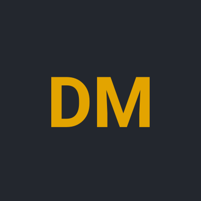

---
hide:
  - navigation
  - toc
---

<!-- Profilbild: Datei nach docs/assets/images/ legen und den Pfad hier anpassen (siehe README) -->
{ .portfolio-avatar width="160" height="160" }

# Dodoe Rumiñahui Mannale

System Engineer aus Zürich mit Fokus auf Automatisierung und AI.

Mein Schwerpunkt ist die Automatisierung von Infrastruktur und Prozessen rund um Microsoft 365 und Azure. Zunehmend arbeite ich auch mit AWS und automatisiere dort Infrastruktur und Deployments. Daneben baue ich AI-Systeme, die ich im Alltag wirklich einsetze. Hier sammle ich meine Semesterarbeiten aus dem Studium Dipl. Informatiker/in HF, Lehrgang Cloud-native Engineer, an der TBZ sowie eigene Projekte. Die Liste wird laufend ergänzt.

[Lebenslauf](cv.md) | [Über mich](ueber-mich.md) | <!-- kontakt -->

<!-- projekte -->
